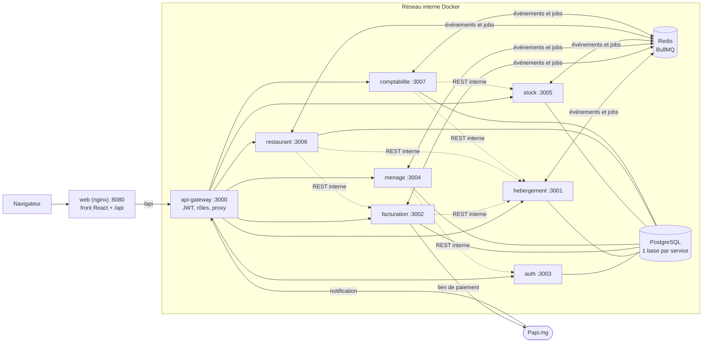

# Architecture du projet Hôtel & Restaurant

> Ce document explique **comment le système est construit et pourquoi**, en une seule lecture.
> Pour le détail fonction par fonction, voir [ETUDE-DU-CODE.md](ETUDE-DU-CODE.md). Pour l'historique des décisions, voir [GUIDE.md](GUIDE.md). Pour les tables, voir [conception/dictionnaire-des-donnees.md](conception/dictionnaire-des-donnees.md).

Sommaire

1. [Vue d'ensemble](#1-vue-densemble)
2. [Les composants](#2-les-composants)
3. [Les six règles d'architecture](#3-les-six-règles-darchitecture)
4. [Le trajet d'une requête](#4-le-trajet-dune-requête)
5. [La communication entre services](#5-la-communication-entre-services)
6. [La sécurité en couches](#6-la-sécurité-en-couches)
7. [L'organisation du code](#7-lorganisation-du-code)
8. [Les données](#8-les-données)
9. [Les tâches de fond](#9-les-tâches-de-fond)
10. [Le déploiement](#10-le-déploiement)
11. [Les tests et l'outillage](#11-les-tests-et-loutillage)

---

## 1. Vue d'ensemble

Le projet est une application de gestion d'hôtel et de restaurant (réservations, paiements Mobile Money via Papi.mg, ménage, stock, restaurant, comptabilité), construite en **microservices** :

- **8 services backend** indépendants, en TypeScript (Node 24, Express 5) ;
- **une base PostgreSQL par service** ;
- **un seul point d'entrée**, la gateway ;
- des **événements** asynchrones entre services, transportés par **BullMQ** sur Redis ;
- un **front** React 19 (Vite, TanStack Query, React Router, Tailwind) ;
- un **monorepo** pnpm qui contient tout.



Flèches pleines : requêtes des utilisateurs. Flèches pointillées : appels REST **entre services**, protégés par la clé interne.

---

## 2. Les composants

| Composant | Port | Responsabilité | Base |
|---|---|---|---|
| **web** (nginx) | 8080 | sert le front React, et transmet `/api/*` à la gateway (même origine : le cookie de session fonctionne sans CORS) | — |
| **api-gateway** | 3000 | **seule porte d'entrée** : vérifie le JWT, applique la table des droits, transmet au bon service | — |
| **auth** | 3003 | comptes, mots de passe (`scrypt`), jetons JWT (EdDSA), sessions par cookie | `auth_db` |
| **hebergement** | 3001 | catégories, chambres, réservations, check-in / check-out, expiration des réservations non payées | `hebergement_db` |
| **facturation** | 3002 | factures, lignes, paiements Papi.mg et espèces, anomalies de paiement | `facturation_db` |
| **menage** | 3004 | tâches de ménage, déclaration des articles remplacés | `menage_db` |
| **stock** | 3005 | articles d'accueil, mouvements, seuils d'alerte | `stock_db` |
| **restaurant** | 3006 | menus, plats, commandes, imputation sur la chambre | `restaurant_db` |
| **comptabilite** | 3007 | copies des factures, reversements au restaurant, tableau de bord quotidien | `comptabilite_db` |
| **PostgreSQL 17** | 5432 | un **conteneur**, mais **une base séparée par service** | — |
| **Redis 7** | 6381 → 6379 | files BullMQ : événements et tâches de fond | — |
| **packages/commun** | — | code **transversal** partagé (`@hotel/commun`), **sans aucune logique métier** | — |

Seuls **web** (8080) et **api-gateway** (3000) sont publiés hors de Docker. Les services ne sont joignables que depuis le réseau interne.

---

## 3. Les six règles d'architecture

1. **Une base par service, aucune clé étrangère entre services.** Un service ne lit **jamais** la base d'un autre. Quand facturation parle d'une réservation, elle garde `reservationId` (un simple UUID) **et une copie** des données utiles au moment T (le **snapshot**) : une facture émise ne change plus, même si le nom du client change ensuite.
2. **La gateway est la seule porte.** Elle authentifie, autorise, puis transmet. Les services font confiance aux en-têtes d'identité **parce qu'ils ne sont pas joignables autrement** et qu'ils exigent la clé interne.
3. **Synchrone si j'ai besoin de la réponse maintenant, asynchrone sinon.** « Ce client a-t-il un séjour en cours ? » passe en REST, car le restaurant attend la réponse. « Le séjour est terminé » est un **événement** : ménage et facturation réagissent chacun à leur rythme.
4. **Aucun événement perdu : l'outbox.** Un événement est écrit **dans la même transaction** que la donnée métier, puis publié après le commit (section 5).
5. **Chaque consommateur est idempotent.** Un événement peut arriver deux fois ; le traiter deux fois donne le même résultat qu'une seule fois.
6. **Les règles critiques sont garanties par la base**, pas seulement par le code : contrainte `EXCLUDE` contre le surbooking, `CHECK` contre le surpaiement, index uniques contre les doublons, mises à jour conditionnelles contre les accès concurrents.

---

## 4. Le trajet d'une requête

Exemple : un client réserve une chambre, `POST /api/reservations`.

```
Navigateur
  │  POST /api/reservations   Authorization: Bearer <JWT>
  ▼
web (nginx :8080)                          location /api/ → api-gateway:3000
  ▼
api-gateway (:3000)
  1. helmet, CORS, journal
  2. RETIRE x-utilisateur-id, x-utilisateur-role, x-cle-interne envoyés par le client
  3. cherche la règle dans REGLES : POST /reservations → hebergement, rôles CLIENT ou réception
  4. vérifie le JWT (clé publique EdDSA, émetteur, audience, expiration) puis le rôle
  5. AJOUTE x-utilisateur-id, x-utilisateur-role et x-cle-interne
  6. transmet (proxy) à hebergement, sans le préfixe /api
  ▼
hebergement (:3001)
  7. helmet → express.json → journal → exigerCleInterne
  8. app.ts → reservation.routes.ts → controller.creer
  9. creerReservationSchema.parse(req.body)                 (Zod : 400 si invalide)
 10. service.creerReservation :
       - calcule le montant à partir des tarifs (jamais reçu du client)
       - pour chaque chambre candidate, UNE transaction :
           réservation + nuitées + ligne outbox « reservation.creee »
           (contrainte EXCLUDE : si la chambre vient d'être prise → chambre suivante)
       - après le commit : job d'expiration différé de 30 min
 11. res.status(201).json(réservation)
  ▼
… 2 s plus tard, de façon asynchrone :
relais outbox (hebergement) → file evt.facturation.reservation.creee
  ▼
facturation : consommateur idempotent → émet la facture du séjour
```

**En cas d'erreur**, personne n'écrit de `try / catch` dans les contrôleurs : Express 5 transmet l'erreur au **gestionnaire d'erreurs commun**, qui la traduit :

| Erreur | Réponse |
|---|---|
| `ZodError` | 400, avec le détail par champ |
| `AppError` (`NotFound`, `RegleMetier`, `Conflit`…) | son propre code : 401, 403, 404, 409, 422, 502… |
| erreur PostgreSQL connue (contrainte nommée, P2002…) | traduite (par exemple 409 `CHAMBRE_INDISPONIBLE`) |
| toute autre erreur | 500, **sans aucun détail** pour le client ; le détail complet part dans les journaux |

---

## 5. La communication entre services

### 5.1 Deux modes

| Mode | Quand | Comment | Exemple |
|---|---|---|---|
| **REST interne** | j'ai besoin de la réponse **tout de suite** | `fetch` vers `http://<service>:<port>/interne/…`, avec l'en-tête `x-cle-interne` | le restaurant demande à hebergement si la chambre 204 a un séjour en cours |
| **événement** | je **constate un fait**, d'autres réagiront | outbox → relais → BullMQ → consommateur | `sejour.termine` → ménage crée une tâche, facturation clôture la facture si elle est soldée |

Les routes `/interne/…` ne figurent **pas** dans la table des droits de la gateway : un navigateur ne peut pas les atteindre.

### 5.2 Le chemin d'un événement

```
SERVICE ÉMETTEUR                              REDIS                    SERVICE CONSOMMATEUR
┌──────────────────────────────┐
│ transaction PostgreSQL :      │
│   donnée métier               │
│ + ligne outbox_evenement      │  ① les deux, ou aucun
└──────────────┬───────────────┘
               │ ② job relais-outbox, toutes les 2 s
               ▼
   lit les lignes non publiées ──► une copie par abonné ──► file evt.<consommateur>.<type>
   marque publie_le                    jobId = id de l'événement      │
                                       (doublon ignoré par BullMQ)    │ ③ worker
                                                                      ▼
                                                    estEnveloppe : Zod revérifie le contenu
                                                    traiterUneFois : dans UNE transaction,
                                                      INSERT evenement_traite (PK = id)
                                                      + effet métier
                                                    doublon → la PK refuse → rien n'est rejoué
```

| Étape | Problème évité |
|---|---|
| ① outbox dans la transaction | la **double écriture** : base modifiée mais message jamais envoyé, ou message envoyé pour une transaction annulée |
| ② relais après le commit | aucun appel réseau dans une transaction ; si Redis est en panne, les événements attendent en base |
| `jobId` = id de l'événement | un relais qui publie deux fois ne crée qu'un job |
| ③ `evenement_traite` | la vraie garantie d'idempotence côté consommateur |
| `UnrecoverableError` si le contenu est invalide | inutile de réessayer un message qui ne sera jamais valide |
| `attempts: 8`, délai exponentiel | une panne passagère (base qui redémarre) est rattrapée automatiquement |

BullMQ est une **file de tâches**, pas un système de diffusion : un job n'est lu que par **un** worker. C'est pourquoi le relais dépose **une copie par abonné**, dans une file nommée `evt.<consommateur>.<type>`.

### 5.3 Le catalogue des événements

Les contrats (schémas Zod) et les abonnements sont définis **une seule fois**, dans [packages/commun/src/evenements.ts](../packages/commun/src/evenements.ts). Le type du contenu est déduit du schéma : un producteur qui envoie un contenu faux ne compile pas.

| Événement | Émetteur | Consommateurs |
|---|---|---|
| `reservation.creee` | hebergement | facturation (émet la facture du séjour) |
| `reservation.confirmee` | hebergement | — (notification, V2) |
| `paiement.recu` | facturation | hebergement (confirme la réservation), restaurant |
| `sejour.commence` | hebergement | menage (tâches quotidiennes) |
| `sejour.termine` | hebergement | menage (ménage de départ), facturation |
| `menage.termine` | menage | hebergement (chambre à valider), stock (sorties d'articles) |
| `stock.seuil_atteint` | stock | — (notification, V2) |
| `consommation.imputee` | restaurant | facturation (ajoute la consommation à la facture de la chambre) |
| `facture.cloturee` | facturation | comptabilite (copie pour le comptable) |

Un événement sans consommateur est **quand même émis** : le jour où le service de notification existera, il s'abonnera sans qu'on modifie l'émetteur.

---

## 6. La sécurité en couches

Chaque couche suppose que la précédente peut échouer (**défense en profondeur**).

| Couche | Où | Protège contre |
|---|---|---|
| HTTPS, redirection, HSTS | proxy devant la gateway en production ; en-têtes `helmet` | écoute du réseau, homme du milieu |
| en-têtes de sécurité (`helmet`) | chaque `app.ts` | attaques visant le navigateur (type de contenu deviné, iframe…) ; ne dévoile pas `X-Powered-By` |
| CORS limité à `FRONT_URL` | gateway | appels de l'API depuis un autre site |
| limitation des **échecs** de connexion (10 par 15 min) | gateway, `POST /api/auth/connexion` | force brute sur les mots de passe |
| suppression des en-têtes d'identité reçus | gateway | un client qui écrirait lui-même `x-utilisateur-role: ADMIN` |
| JWT EdDSA court (15 min) | auth **signe** (clé privée), gateway **vérifie** (clé publique) | jetons forgés ; un jeton volé expire vite |
| session par cookie `httpOnly` (7 jours), jeton stocké **haché** | auth | vol du jeton par un script ; fuite de la base |
| table des droits `REGLES`, **refus par défaut** | gateway | accès à une route sans le bon rôle ; une route absente répond 404 |
| clé interne (comparaison en temps constant) | chaque service, `exigerCleInterne` | appel direct d'un service sans passer par la gateway |
| revérification du rôle sur les routes sensibles (`exigerRoles`) | services | erreur de configuration de la gateway |
| validation Zod de **toute** entrée | contrôleurs, `env.ts`, consommateurs | données malformées ; champs pirates (`role`, `montant`) retirés |
| montants **toujours** calculés par le serveur | services | un client qui fixerait lui-même son prix |
| paiement : jeton de notification haché, montant et référence revérifiés, statut lu côté serveur | facturation | fausse notification de paiement ; `successUrl` n'est jamais une preuve |
| contraintes SQL | migrations | surbooking, surpaiement, doublons, même en cas de bug ou de requêtes simultanées |

---

## 7. L'organisation du code

### 7.1 Le monorepo

```
hotel-restaurant/
├── apps/web/                 front React 19 + Vite
├── packages/commun/          @hotel/commun : code transversal partagé
├── services/                 les 8 services backend
├── docker/                   Dockerfiles, nginx.conf, script de démarrage, init Postgres
├── docker-compose.yml        infrastructure (dev) ou application complète (profil app)
├── scripts/                  génération des secrets, données de démo, scénarios de bout en bout
├── docs/                     documentation
├── .changeset/               versionnage des paquets
└── pnpm-workspace.yaml       déclare services/*, apps/*, packages/*
```

Les services importent `@hotel/commun` grâce à `"@hotel/commun": "workspace:*"` : pnpm crée un **lien** vers `packages/commun`. Les services chargent son code **compilé** (`dist/`) : après chaque modification de `commun`, il faut lancer `pnpm --filter @hotel/commun build`.

### 7.2 Ce que contient `packages/commun`

| Fichier | Rôle |
|---|---|
| `erreurs.ts` | `AppError` et ses fabriques (`NotFound`, `RegleMetier`, `Conflit`, `NonAutorise`, `Interdit`) |
| `gestionnaire-erreurs.ts`, `erreurs-base.ts` | le gestionnaire d'erreurs commun ; la lecture des erreurs PostgreSQL |
| `identite.ts`, `roles.ts` | les 7 rôles, la lecture de l'identité posée par la gateway, `exigerRoles` |
| `cle-interne.ts` | `exigerCleInterne`, comparaisons en temps constant, empreintes SHA-256 |
| `validation.ts` | `lireId` (`:id` validé comme UUID) |
| `evenements.ts` | contrats Zod des événements, abonnements, types génériques |
| `bus.ts` | `BusEvenements` : **le seul** endroit où sont créés les `Queue` et `Worker` BullMQ |
| `outbox.ts` | le relais de l'outbox, la détection des doublons |
| `logger.ts` | journaux `pino` et journal des requêtes |
| `temps.ts` | dates à l'heure de Madagascar |

Règle : **aucune logique métier** dans `commun`. Sinon, une règle de facturation obligerait à retester les 8 services.

### 7.3 La structure d'un service

Tous les services ont la même forme : en comprendre un, c'est les comprendre tous.

```
services/<service>/
├── prisma/schema.prisma        les tables du service
├── prisma/migrations/          le SQL appliqué, dont les contraintes écrites à la main (EXCLUDE, CHECK…)
├── src/config/env.ts           variables d'environnement validées par Zod : le service refuse de démarrer sinon
├── src/db.ts                   l'instance UNIQUE de PrismaClient
├── src/logger.ts               le logger du service
├── src/bus.ts                  l'instance UNIQUE de BusEvenements
├── src/outbox.ts               ecrireEvenement (dans la transaction), traiterUneFois (côté consommateur)
├── src/modules/<module>/
│   ├── <module>.routes.ts      quelle URL → quel contrôleur
│   ├── <module>.controller.ts  lit et valide la requête, appelle le service, répond (1 à 5 lignes)
│   ├── <module>.service.ts     règles métier et accès à la base ; ne connaît ni req ni res
│   └── <module>.schema.ts      schémas Zod des entrées et types déduits
├── src/app.ts                  assemble Express (ordre : sécurité → routes publiques → clé interne → modules → erreurs)
├── src/jobs.ts                 workers BullMQ : relais, consommateurs d'événements, tâches planifiées
├── src/server.ts               démarre HTTP et les jobs ; arrêt propre sur SIGTERM
└── tests/                      Vitest + Supertest sur une vraie base *_test_db
```

**Pourquoi séparer contrôleur et service ?** Le service est appelé **sans HTTP** : par un worker (événement), un job planifié ou un test. Une règle écrite dans le contrôleur devrait être recopiée.

**Pourquoi séparer `app.ts` et `server.ts` ?** Les tests importent `app` et lui envoient des requêtes directement, sans ouvrir de port ni démarrer de workers.

---

## 8. Les données

- **Prisma 7** (client généré par service, adaptateur `pg`) ; les migrations sont versionnées dans chaque service.
- **Les montants** sont des **entiers en Ariary**, jamais des nombres à virgule.
- **Les dates de séjour** sont des colonnes `DATE` ; « aujourd'hui » se calcule à l'heure de **Madagascar** (`Indian/Antananarivo`), jamais selon le fuseau du serveur.
- **Le snapshot** : chaque service copie les données d'un autre service dont il a besoin (nom du client, montant, numéro de chambre) au moment de l'événement.
- **Les états** (réservation, paiement, facture, tâche) suivent une **machine à états** : les transitions permises sont déclarées dans une table (`transitions.ts`), et chaque changement d'état est une mise à jour **conditionnelle** (`updateMany … where statut = …`), sûre même avec des requêtes simultanées.
- **L'idempotence des requêtes** : `POST /reservations` accepte un en-tête `Idempotency-Key` ; un double clic ne crée pas deux réservations.

Le détail de chaque table est dans [conception/dictionnaire-des-donnees.md](conception/dictionnaire-des-donnees.md).

---

## 9. Les tâches de fond

| Tâche | Service | Déclenchement | Rôle |
|---|---|---|---|
| `relais-outbox` | hebergement, facturation, menage, stock, restaurant | toutes les 2 s | publier les événements en attente |
| expiration d'une réservation | hebergement | job **différé** de 30 min, `jobId` = réservation | libérer la chambre si le client ne paie pas |
| `balayage-expirations` | hebergement | toutes les minutes | filet de sécurité si un job d'expiration a été perdu |
| `purge-idempotence` | hebergement | chaque nuit à 3 h (Madagascar) | supprimer les clés d'idempotence de plus de 7 jours |
| notifications Papi | facturation | à la réception, 8 essais, délai exponentiel | la route répond tout de suite ; le paiement est traité dans le worker |
| `tableau-de-bord` | comptabilite | chaque jour à 23 h (Madagascar) | compter les factures, comparer nuitées vendues et sorties de stock, signaler les écarts |

Les tâches répétables sont des *job schedulers* BullMQ : même avec plusieurs instances d'un service, chacune ne s'exécute qu'une fois à la fois.

---

## 10. Le déploiement

| Commande | Ce qui démarre |
|---|---|
| `docker compose up -d` | **développement** : PostgreSQL et Redis seulement ; les services tournent sur la machine avec `pnpm dev` (`tsx watch`) |
| `docker compose --profile app up -d --build` | **application complète** : tous les services, la gateway, le front (nginx) et un faux Papi pour la démonstration |

- **Une seule image** pour les 8 services ([docker/app.Dockerfile](../docker/app.Dockerfile)) : elle installe, compile `commun`, génère les clients Prisma et compile chaque service. Chaque conteneur choisit son service avec la variable `SERVICE`.
- **Au démarrage d'un conteneur** ([docker/demarrer.sh](../docker/demarrer.sh)) : `prisma migrate deploy` applique les migrations, puis `node dist/server.js`.
- **Le front** ([docker/web.Dockerfile](../docker/web.Dockerfile), [docker/nginx.conf](../docker/nginx.conf)) : nginx sert les fichiers React et transmet `/api/` à la gateway. Toute autre URL renvoie `index.html` (React Router).
- **Les secrets** (`CLE_INTERNE`, clés JWT) sont générés par `scripts/generer-env-docker.sh` dans un `.env` à la racine, **jamais commité**.
- **Arrêt propre** : sur `SIGTERM` (`docker stop`), chaque service cesse d'accepter des requêtes, laisse finir les jobs en cours, ferme Redis, puis la base.
- **En production**, un proxy (Caddy, Nginx ou un hébergeur) doit être placé devant pour HTTPS et la redirection HTTP → HTTPS.

---

## 11. Les tests et l'outillage

| Outil | Usage |
|---|---|
| **Vitest + Supertest** | tests d'intégration de chaque service, sur une **vraie** base `<service>_test_db` (jamais la base de dev) et un préfixe Redis séparé |
| `pnpm test` | tous les tests ; ils s'exécutent **l'un après l'autre** (les fichiers partagent la base de test) |
| `pnpm typecheck` | `tsc --noEmit` sur le code **et** les tests de chaque paquet |
| **TDD** | chaque correction commence par un test qui échoue |
| **Changesets** | chaque changement de code est accompagné d'un fichier `.changeset/*.md` (patch, minor…) pour le versionnage |
| `scripts/scenario-*.sh` | scénarios de bout en bout via la gateway |

Méthode de travail : **une issue = une branche = une PR** (`Closes #N`).

---

*Voir aussi : [ETUDE-DU-CODE.md](ETUDE-DU-CODE.md) (fonctionnalité par fonctionnalité), [GUIDE.md](GUIDE.md) (décisions et journal des phases), [GUIDE-DE-TEST.md](GUIDE-DE-TEST.md).*
