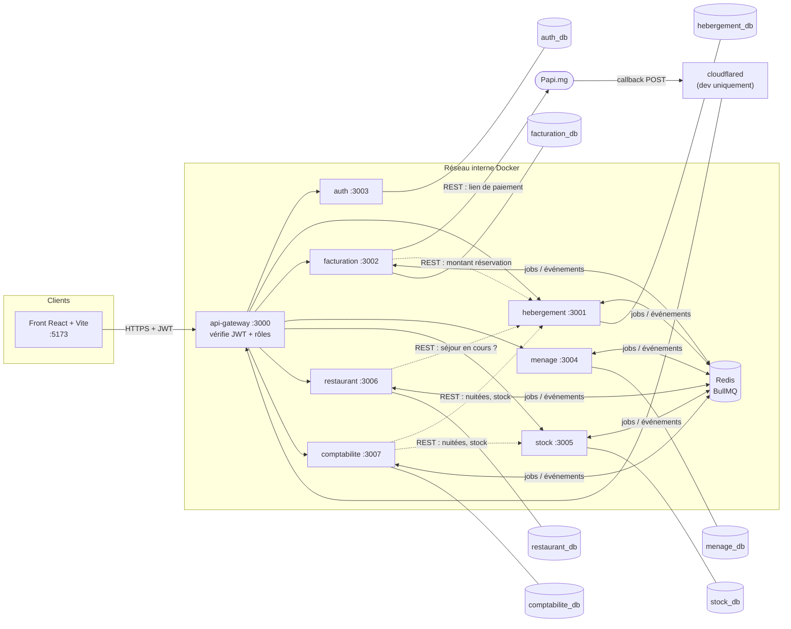
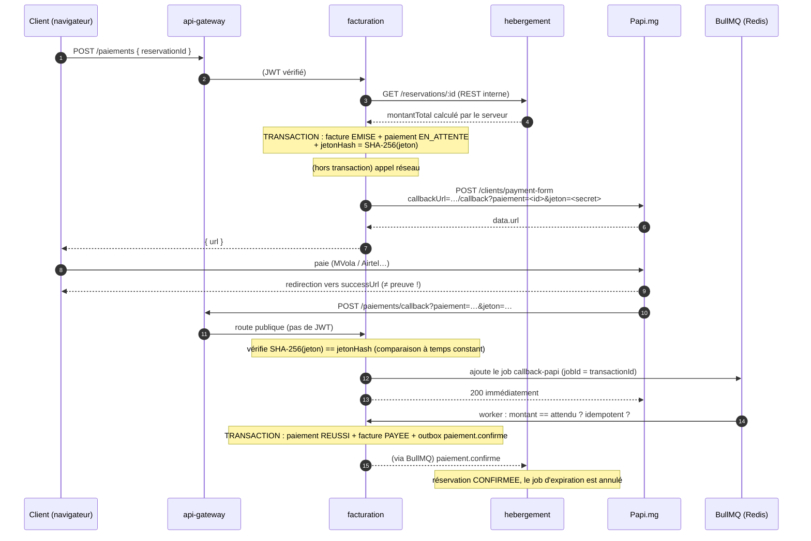
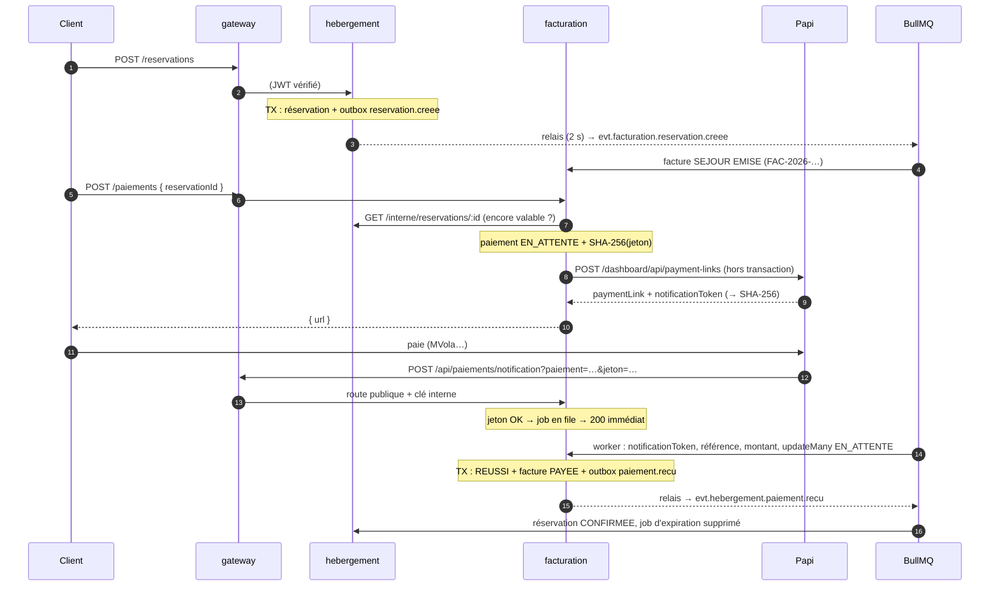

# Guide du projet Hôtel & Restaurant

> Document vivant. La phase 0 (ce document) décrit **où on va et pourquoi**.
> Chaque phase suivante ajoute une section « Journal » en fin de fichier :
> ce qui a été fait, le code important expliqué, les pièges rencontrés.

Sommaire

1. [Audit du dépôt (état au 30/09/2026)](#1-audit-du-dépôt-état-au-30092026)
2. [Architecture](#2-architecture)
3. [Du BPMN au code : services, routes, événements](#3-du-bpmn-au-code--services-routes-événements)
4. [Le paiement Papi.mg de bout en bout](#4-le-paiement-papimg-de-bout-en-bout)
5. [Choix techniques : pourquoi lui et pas l'autre](#5-choix-techniques--pourquoi-lui-et-pas-lautre)
6. [Plan des phases](#6-plan-des-phases)
7. [Questions d'entretien probables](#7-questions-dentretien-probables)
8. [Décisions à valider avant la phase 1](#8-décisions-à-valider-avant-la-phase-1)

---

## 1. Audit du dépôt (état au 30/09/2026)

### 1.1 Ce qui existe

| Élément | État |
|---|---|
| Monorepo pnpm (`services/*`, `apps/*`), Node 24.21, pnpm 12.5.1 | OK |
| `docker-compose.yml` : Postgres 17 (hôte **5432**), Redis 7 (hôte **6381** → 6379) | OK, mais seulement ces deux conteneurs |
| `docker/postgres/init.sql` : crée `hebergement_db` et `facturation_db` | OK, incomplet (voir 1.3) |
| **hebergement** : Prisma 7.10.0 + adapter-pg, 2 migrations (init + contraintes métier : EXCLUDE anti-surbooking, CHECK), modules `categorie`, `chambre`, `reservation`, gestionnaire d'erreurs, tarif par saison | Fonctionne, `tsc` passe, plusieurs bugs (1.3) |
| **facturation** : schéma Prisma, migration init, `papi.ts`, `queue.ts`, `worker.ts`, `numero.ts`, `hebergement.ts` | Plus avancé que « rien d'autre », mais **`tsc` échoue** et la base est incomplète (1.3) |
| `apps/web` | Dossier vide |
| Tests | Aucun (Vitest et Supertest sont installés dans hebergement, mais rien n'est écrit) |
| `docs/` | **N'existait pas** avant ce guide |

### 1.2 Ce qui manque

- **Documents de référence** : `docs/bpmn/workflow-hotel-restaurant.bpmn` n'est pas dans le dépôt. Je l'ai trouvé dans `~/Téléchargements/Workflow Hotel Restaurant.bpmn` et c'est lui que j'ai analysé. `docs/modele-donnees.md` **n'existe nulle part** sur la machine.
- Services : `auth`, `menage`, `stock`, `restaurant`, `comptabilite`, `api-gateway`.
- Dans facturation : `app.ts`, `server.ts`, les routes, la route de callback Papi, les scripts `dev`/`start` du `package.json`.
- Un paquet partagé (erreurs, logger, types d'événements), aujourd'hui dupliqué par copier-coller.
- Pino (installé dans hebergement, jamais utilisé : on trouve des `console.error`).
- Le job d'expiration à 30 minutes, le check-in, le check-out, les événements BullMQ.
- Le seed, le README, le front, le docker-compose complet.

### 1.3 Ce qui est à corriger (par gravité)

#### Bloquant

| # | Où | Problème | Correction prévue |
|---|---|---|---|
| B1 | `services/facturation/prisma/schema.prisma` | `enum TypeFacture { SEJOUR` et `enum MethodePaiement { MVOLA` : **Prisma ignore sans rien dire la valeur écrite sur la même ligne que `{`**. Résultat : en base, `TypeFacture` = `RESTAURANT` seul et `MethodePaiement` n'a pas `MVOLA`. `prisma validate` dit « valide », mais `tsc` échoue (`worker.ts:48`). | Une valeur par ligne, puis `migrate dev --name enums_complets` et `generate`. C'est un ajout de valeurs d'enum, sans perte de données. |
| B2 | `hebergement/.../categorie.service.ts` | `listerCategories` utilise des accolades **sans `return`** : `GET /categories` renvoie une réponse vide. | Retourner la promesse. |
| B3 | `hebergement` `POST /reservations/:id/confirmer` | Route **publique** : n'importe qui peut confirmer une réservation sans payer. | La confirmation ne passera plus par une route publique : elle sera déclenchée par l'événement `paiement.confirme` venant de facturation. |

#### Important

| # | Où | Problème | Correction prévue |
|---|---|---|---|
| I1 | `hebergement/src/middlewares/erreur.ts` | `code === "P2010"` transforme **toute** erreur de requête brute en « chambre indisponible ». La détection de la contrainte EXCLUDE via `meta.constraint` n'a jamais été testée avec l'adapter-pg. `P2002` (doublon) et `P2025` (enregistrement introuvable, par exemple un conflit de version) finissent en 500. | Un traducteur d'erreurs Prisma couvert par un test qui provoque vraiment le chevauchement. |
| I2 | contrôleurs hebergement | `:id` n'est pas validé : `GET /chambres/abc` provoque une erreur Postgres « uuid invalide », donc un 500 au lieu d'un 400. | Schéma Zod `z.object({ id: z.uuid() })` pour les paramètres. |
| I3 | `reservation.service.ts` `listerReservations` | `statut as never` : un cast qui fait taire TypeScript, aussi dangereux qu'un `any`. | Valider `req.query` avec `z.enum(...)`. |
| I4 | `genererReference` | 6 derniers chiffres de `Date.now()` : ils reviennent au même point toutes les ~16 minutes, et deux requêtes dans la même milliseconde se percutent. On obtient alors une erreur `P2002`, donc un 500. | Compteur annuel en base, comme `numero.ts` dans facturation. |
| I5 | Modèle de réservation | Le client doit fournir un `chambreId`, alors que sur le site il choisit une **catégorie**. | Voir la décision D3 (section 8). |
| I6 | `facturation/src/worker.ts` | Lecture puis écriture non atomiques : deux callbacks différents pour le même paiement peuvent **encaisser deux fois**. | `updateMany({ where: { id, statut: "EN_ATTENTE" } })`, puis vérifier `count`. |
| I7 | `worker.ts` | Un montant incohérent est marqué `ECHOUE`, alors que l'argent a été débité : l'anomalie est perdue. | Nouveau statut `ANOMALIE`, à traiter à la main. |
| I8 | `facturation/src/papi.ts` | Les codes Papi sont incomplets, et **la documentation officielle actuelle décrit une autre API** (voir 4.4). | À trancher (décision D1). |
| I9 | Racine `package.json` | `pnpm --filter @hotel/hebergement` alors que le paquet s'appelle `hebergement` : le filtre ne trouve rien. | Nommer tous les paquets `@hotel/<service>`. |
| I10 | `services/facturation/.agents/` + `skills-lock.json` | Des skills Prisma pour agent IA (dont MongoDB et Prisma Compute, hors sujet), non ignorés par git : un `git add .` les commiterait dans le service. | Décision D6. |

#### Mineur

- `.gitignore` des deux services : `src/generated/` répété 3 fois.
- `src/config/env.ts` existe (validation Zod des variables), mais `db.ts` et `server.ts` lisent encore `process.env` directement.
- `facturation/src/db.ts` : le message d'erreur parle du « service hebergement » (copier-coller).
- `facturation/package.json` : `"prisma": "^7.10.0"` au lieu de `"7.10.0"` épinglé, et pas de `"private": true`.
- `queue.ts` : `Number(url.port)` vaut `0` si l'URL n'a pas de port, et le mot de passe Redis est ignoré.
- `reservation.schema.ts` : « arrivée dans le passé » compare minuit UTC à minuit **local du serveur**. Il faut raisonner explicitement en heure de Madagascar (`Indian/Antananarivo`, UTC+3).
- `dotenv` est installé mais inutile (on utilise `process.loadEnvFile()` et `--env-file`).
- `init.sql` ne s'exécute **qu'au premier démarrage** du volume : les bases des nouveaux services devront être créées une fois à la main (commande fournie en phase 1).
- **BPMN** : le fichier contient **deux pools « Client » identiques** (`Process_1balt7l` et `Process_0kcf9v5`), et des flux de messages en double ou sans nom. C'est à nettoyer dans le modeler, car un jury le verra.
- Du travail n'est pas commité (modules hebergement, tout facturation) : il faut commiter avant la phase 1.

---

## 2. Architecture

### 2.1 Vue d'ensemble



Toutes les bases vivent dans **le même conteneur Postgres**, mais chacune est une base séparée qui appartient à un seul service. Un service ne se connecte jamais à la base d'un autre.

### 2.2 Ports

| Composant | Port | Exposé hors Docker ? |
|---|---|---|
| api-gateway | 3000 | **Oui** : le seul point d'entrée |
| hebergement | 3001 | Non (oui en dev local via `tsx`) |
| facturation | 3002 | Non |
| auth | 3003 | Non |
| menage | 3004 | Non |
| stock | 3005 | Non |
| restaurant | 3006 | Non |
| comptabilite | 3007 | Non |
| Front (Vite) | 5173 | Oui |
| Postgres | 5432 | Oui (pour psql / Prisma en dev) |
| Redis | 6381 → 6379 | Oui (dev) |

### 2.3 Les quatre règles qui structurent tout

1. **Une base par service, aucune clé étrangère entre services.** Quand facturation parle d'une réservation, elle stocke `reservationId` (un simple UUID, sans FK) **et une copie** des données utiles au moment T (`clientNom`, `montant`…). C'est le **snapshot**. Si l'hébergement modifie plus tard le nom du client, la facture émise ne change pas, et c'est voulu : une facture est un document figé.
2. **La gateway est la seule porte.** Elle vérifie le JWT et le rôle, **retire** les en-têtes d'identité envoyés par le client, puis ajoute les siens (`X-Utilisateur-Id`, `X-Utilisateur-Role`). Les services font confiance à ces en-têtes uniquement parce qu'ils ne sont pas joignables depuis l'extérieur.
3. **Synchrone si j'ai besoin de la réponse maintenant, asynchrone sinon.** Par exemple, « Ce client a-t-il un séjour en cours ? » passe en REST, car le serveur du restaurant attend la réponse. « Le séjour est terminé » passe par BullMQ, car le ménage, la facturation et le stock réagiront chacun à leur rythme.
4. **Chaque consommateur est idempotent.** Un message peut arriver deux fois (réessai, redémarrage). Le traiter deux fois doit donner le même résultat que le traiter une fois.

### 2.4 Comment on publie un événement sans le perdre (outbox)

Le problème, dit « double écriture » : je mets à jour la base **puis** j'envoie le message dans Redis. Si le processus plante entre les deux, la base dit « séjour terminé » mais personne n'est prévenu. Si j'envoie d'abord, et que la transaction échoue, j'ai annoncé quelque chose de faux.

La solution, dite **outbox**, se déroule ainsi :

1. Dans **la même transaction** que la modification métier, j'insère une ligne dans une table `outbox` (`id`, `type`, `payload`, `publieLe = null`).
2. Un petit job répétable BullMQ (toutes les 2 s) lit les lignes non publiées, les pousse dans les files, puis remplit `publieLe`.
3. Si le relais plante après l'envoi mais avant la mise à jour, il renverra le message. Ce n'est pas grave, puisque les consommateurs sont idempotents (règle 4).

Cela respecte aussi la règle « jamais d'appel réseau dans une transaction » : l'envoi vers Redis a lieu *après* le commit.

### 2.5 Comment BullMQ transporte un événement

BullMQ est une **file de tâches**, pas un système de publication/abonnement : un job n'est consommé que par **un seul** worker. Pour qu'un événement touche plusieurs services, on crée **une file par couple (événement, consommateur)** :

```
sejour.termine  ──►  file "menage:sejour.termine"
                ──►  file "facturation:sejour.termine"
```

Le relais de l'outbox connaît la liste des abonnés (déclarée dans le paquet partagé) et ajoute un job dans chaque file. Il utilise `jobId = <id de l'événement>` : si BullMQ reçoit deux fois le même `jobId`, il ignore le second. C'est une **première** barrière contre les doublons. La **seconde**, qui est la vraie garantie, est une table `evenement_traite (id PK)` dans chaque service consommateur, remplie dans la même transaction que l'effet métier.

---

## 3. Du BPMN au code : services, routes, événements

Rôles = lanes du BPMN : `RECEPTIONNISTE`, `FEMME_MENAGE`, `RESTAURANT`, `COMPTABLE`, `COMMUNICATION`, plus `ADMIN` et `CLIENT`.

### 3.1 Correspondance tâche BPMN → code

| Lane / pool | Tâche ou événement BPMN | Service | Route ou mécanisme | Rôle | Événement émis |
|---|---|---|---|---|---|
| Client | Consulter les tarifs (site / Facebook) | hebergement | `GET /tarifs` (public) | — | — |
| Client | Réserver une chambre (avec pièce d'identité) | hebergement | `POST /reservations` | CLIENT ou RECEPTIONNISTE | — |
| Réceptionniste | Vérifier la disponibilité d'une chambre | hebergement | Dans `POST /reservations` : contrainte EXCLUDE | — | — |
| Réceptionniste | Informer le client de l'indisponibilité | hebergement | Réponse `409 CHAMBRE_INDISPONIBLE` | — | — |
| Réceptionniste | Émettre la facture | facturation | `POST /paiements` (crée la facture SEJOUR et le lien Papi) | CLIENT ou RECEPTIONNISTE | — |
| Client | Payer la facture | Papi.mg | Redirection vers `data.url` | — | — |
| Réceptionniste | Encaisser le montant | facturation | `POST /paiements/callback` (Papi) ou `POST /factures/:id/encaissements` (espèces) | — / RECEPTIONNISTE | `paiement.confirme` |
| *(implicite)* | Réservation non payée en 30 min | hebergement | Job BullMQ **différé** `expirer-reservation` | — | — |
| Réceptionniste | Vérifier la pièce d'identité, Attribuer la chambre | hebergement | `POST /reservations/:id/check-in` (refusé si la chambre n'est pas `PROPRE`) | RECEPTIONNISTE | — |
| Réceptionniste | Date de départ atteinte (minuteur) | hebergement | Job différé planifié au check-in pour le jour du départ à 12 h : il signale le départ à traiter | — | — |
| Réceptionniste | *(fin de séjour)* | hebergement | `POST /reservations/:id/check-out` : chambre `SALE` | RECEPTIONNISTE | `sejour.termine` |
| Femme de ménage | Nettoyer la chambre | menage | `GET /taches`, `POST /taches/:id/demarrer` | FEMME_MENAGE | — |
| Femme de ménage | Remplacer les articles, Notifier la réceptionniste | menage | `POST /taches/:id/terminer` (avec les articles remplacés) | FEMME_MENAGE | `menage.termine` |
| Réceptionniste | Mettre la chambre au statut propre | hebergement | `POST /chambres/:id/propre` (la chambre apparaît dans « à valider » après `menage.termine`) | RECEPTIONNISTE | — |
| *(stock)* | Stock articles (data store) | stock | Consomme `menage.termine` → mouvements `SORTIE` | — | — |
| Restaurant | Définir les menus à la carte | restaurant | `POST /menus`, `POST /plats` | RESTAURANT | — |
| Communication | Publier les menus (site / Facebook) | restaurant | `POST /menus/:id/publier` ; `GET /menus/publies` (public) | COMMUNICATION | — |
| Communication | Demande de tarif, Répondre sur Facebook | hebergement | `GET /tarifs` + écran « réponse type » à copier | COMMUNICATION | — |
| Restaurant | Prendre la commande, Préparer et servir | restaurant | `POST /commandes`, `PATCH /commandes/:id/statut` | RESTAURANT | — |
| Restaurant | Ajouter à la facture de la chambre ? **Oui** : Imputer | restaurant | `POST /commandes/:id/imputer` (vérifie en REST qu'un séjour `EN_COURS` existe) | RESTAURANT | `consommation.imputee` |
| Restaurant | **Non** : Établir la facture restaurant, Encaisser | facturation | `POST /factures` (type RESTAURANT) + encaissement | RESTAURANT | — |
| Réceptionniste | Ajouter les consommations restaurant à la facture | facturation | Consomme `consommation.imputee` → `ligne_facture` avec `origine = RESTAURANT` | — | — |
| Réceptionniste | Clôturer la facture du séjour, Transmettre une copie au comptable | facturation | `POST /factures/:id/cloturer` (exige un solde nul) | RECEPTIONNISTE | `facture.cloturee` |
| Comptable | Copie de facture (data object) | comptabilite | Consomme `facture.cloturee` → `copie_facture` (snapshot) | — | — |
| Comptable | Consommations restaurant incluses ? → Reverser la part restaurant | comptabilite | `GET /reversements`, `POST /reversements/:id/effectuer` | COMPTABLE | — |
| Comptable | Chaque jour à 23 h 00 → Compter les factures, Comparer chambres vendues / stock, Générer le tableau de bord | comptabilite | Job **répétable** BullMQ `0 23 * * *`, fuseau `Indian/Antananarivo` ; `GET /tableaux-de-bord` | COMPTABLE | — |
| Comptable | Écart détecté ? → Signaler à la direction | comptabilite | Champ `ecart` + `alerte` dans le tableau de bord, visible par ADMIN | COMPTABLE, ADMIN | — |
| — | Connexion, gestion des comptes | auth | `POST /auth/connexion`, `POST /auth/inscription` (CLIENT), `GET /auth/moi`, `POST /auth/utilisateurs` (ADMIN) | — / ADMIN | — |

**Interprétation assumée du BPMN.** La tâche s'appelle « Vérifier la disponibilité d'une chambre **propre** », mais une réservation porte sur des dates futures : la propreté du jour n'a pas de sens à ce moment-là. On sépare donc les deux notions :

- **disponible** = aucune réservation active ne chevauche les dates, garanti par la contrainte EXCLUDE ;
- **propre** = vérifié **au check-in**, comme l'exige le sujet (« seules les chambres propres sont attribuées au check-in »).

C'est une question classique en soutenance, il faut savoir la justifier.

### 3.2 Catalogue des événements (BullMQ)

| Événement | Émetteur | Consommateurs | Contenu (snapshot) | Clé d'idempotence |
|---|---|---|---|---|
| `paiement.confirme` | facturation | hebergement | `reservationId`, `paiementId`, `montant` | `paiementId` |
| `sejour.termine` | hebergement | menage, facturation | `reservationId`, `chambreId`, `numeroChambre`, `nbNuits`, `dateDepart` | `reservationId` |
| `menage.termine` | menage | hebergement, stock | `tacheId`, `chambreId`, `articles: [{code, quantite}]` | `tacheId` |
| `consommation.imputee` | restaurant | facturation | `commandeId`, `reservationId`, `lignes`, `montant` | `commandeId` (via `@@unique([origine, sourceId])`) |
| `facture.cloturee` | facturation | comptabilite | La facture complète avec ses lignes et leur `origine` | `factureId` |

Jobs internes, qui ne sont pas des événements :

| Job | Service | Type | Pourquoi |
|---|---|---|---|
| `expirer-reservation` | hebergement | Différé (30 min), `jobId = reservationId` | Libérer la chambre si le client ne paie pas |
| `depart-atteint` | hebergement | Différé (jour du départ, 12 h) | Minuteur BPMN « Date de départ atteinte » |
| `callback-papi` | facturation | Immédiat, 5 essais, délai exponentiel | Le callback répond 200 tout de suite et le traitement se fait ici |
| `relais-outbox` | chaque émetteur | Répétable (2 s) | Publier les événements sans double écriture (2.4) |
| `tableau-de-bord` | comptabilite | Répétable (23 h, heure de Madagascar) | Minuteur BPMN « Chaque jour à 23 h 00 » |

### 3.3 La règle des articles, et pourquoi le comptable peut détecter un écart

- **Attendu** : 1 nuitée vendue = 1 gel douche + 1 papier hygiénique + 1 paire de pantoufles + 1 brosse à dents.
- **Réel** : la femme de ménage déclare ce qu'elle a **effectivement** remplacé (pré-rempli avec `nbNuits × 1` pour chaque article). Le stock décrémente ce **réel**.
- **Contrôle à 23 h** : le comptable compare les nuitées vendues du jour (hebergement) aux sorties de stock du jour (stock). Si les deux ne correspondent pas, il y a un écart et une alerte est levée.

Si le stock était décrémenté automatiquement au check-out, l'attendu et le réel seraient toujours identiques et la tâche BPMN « Comparer » ne servirait à rien.

---

## 4. Le paiement Papi.mg de bout en bout

### 4.1 Déroulé



### 4.2 Les règles de sécurité, et l'attaque que chacune empêche

| Règle | Attaque empêchée |
|---|---|
| Le montant vient du serveur (facturation le redemande à hebergement) | Le client modifie `amount: 1` dans la requête et paie 1 Ar une suite prestige. |
| `callbackUrl` contient un jeton secret aléatoire ; seul son **SHA-256** est stocké | N'importe qui envoie un faux callback « status 200 ». Et si la base fuit, les jetons en clair ne sont pas dedans. |
| Comparer `amount` reçu et `paiement.montant` | Un callback authentique mais pour un autre montant (erreur, lien réutilisé). On passe en `ANOMALIE`, pas en succès. |
| Idempotence sur `transactionId` (`referenceExterne @unique` + `jobId`) | Papi renvoie le même callback trois fois, et on encaisserait trois fois. |
| `successUrl` n'est jamais une preuve | L'utilisateur tape lui-même l'URL `/paiement/succes` dans son navigateur. Cette page se contente d'**interroger** le statut. |
| Jamais d'appel réseau dans une transaction | Papi met 15 s à répondre, la transaction bloque des verrous et une connexion du pool pendant 15 s, et le service s'écroule sous la charge. |
| Le callback répond 200 et délègue à BullMQ | Si le traitement échoue ou est lent, Papi n'attend pas, ne réessaie pas en boucle, et BullMQ réessaie proprement de son côté. |

### 4.3 Tunnel cloudflared en développement

Papi.mg est sur Internet ; ton `localhost:3000` ne l'est pas. Un tunnel crée une URL publique temporaire qui redirige vers ta machine.

```bash
# 1. Installation (Debian, une seule fois)
curl -L -o /tmp/cloudflared.deb \
  https://github.com/cloudflare/cloudflared/releases/latest/download/cloudflared-linux-amd64.deb
sudo dpkg -i /tmp/cloudflared.deb
cloudflared --version

# 2. Lancer le tunnel vers la gateway (laisser ce terminal ouvert)
cloudflared tunnel --url http://localhost:3000
#    → affiche une URL du type https://mots-au-hasard.trycloudflare.com

# 3. Copier cette URL dans services/facturation/.env :
#    PUBLIC_URL=https://mots-au-hasard.trycloudflare.com
#    puis redémarrer facturation (la callbackUrl est construite à partir de PUBLIC_URL)
```

Pièges : ce « tunnel rapide » ne demande pas de compte, mais **l'URL change à chaque lancement**, donc il faut mettre `PUBLIC_URL` à jour à chaque fois. Le tunnel pointe vers la **gateway** (3000), pas directement vers facturation : on garde un seul point d'entrée, même en dev.

### 4.4 ⚠️ Écart entre ton cahier des charges et la documentation officielle

Ton énoncé décrit : `POST https://api.papi.mg/clients/payment-form`, en-tête `AuthentificationKey: Ibonia <clé>`, réponse `data.url`, callback avec `status` (200/400) et `paymentMethod` numérique (2 = MVola, 3 = Airtel Money).

La documentation publique actuelle ([docs.papi.mg, Quick Start](https://docs.papi.mg/docs/quickstart/)) décrit **une autre API** :

- `POST https://app.papi.mg/engine/api/payment-links`, en-tête `Token: <clé>` ;
- champs `notificationUrl`, `reference`, `validDuration`, `provider`… ; réponse `data.paymentLink` et `notificationToken` ;
- notification avec `paymentStatus` = `SUCCESS` / `PENDING` / `FAILED`, `paymentMethod` **textuel** (`MVOLA`, `AIRTEL_MONEY`, `ORANGE_MONEY`, `BRED`) ;
- en-tête de signature `X-Papi-Signature`.

La page de la version 1.0.0 renvoie une erreur 404. **Je n'ai trouvé nulle part les codes numériques** de l'API que tu décris, en dehors des deux que tu m'as donnés. Je n'invente rien : c'est la décision D1.

---

## 5. Choix techniques : pourquoi lui et pas l'autre

| Choix | Alternative écartée | Pourquoi |
|---|---|---|
| **Architecture orientée services** | Monolithe modulaire | C'est l'objet du cours. En entreprise, un monolithe bien découpé serait souvent plus raisonnable pour une équipe de cette taille, et il faut savoir le dire. On évite l'essentiel de la complexité avec une seule machine Postgres et un seul Redis. |
| **BullMQ** pour les messages | **RabbitMQ** | Voir 5.1. |
| **REST** synchrone | gRPC | Lisible avec `curl`, pas de génération de code, suffisant pour ce trafic. gRPC apporte des gains de performance et des contrats stricts qui ne servent pas ici. |
| **PostgreSQL** | MySQL, MongoDB | Types `daterange` et **contraintes EXCLUDE** : l'anti-surbooking est garanti par la base, même si deux requêtes arrivent à la même microseconde. MySQL n'a pas d'équivalent, et MongoDB n'a pas de contraintes relationnelles. |
| Anti-surbooking par **contrainte EXCLUDE** | `SELECT` pour vérifier, puis `INSERT` | Entre le SELECT et l'INSERT, une autre requête peut se glisser (condition de concurrence). La contrainte est vérifiée **au moment de l'écriture**, de façon atomique. |
| **Prisma 7** + adapter-pg | TypeORM, Drizzle, SQL brut | Client typé généré depuis le schéma, migrations versionnées. Prisma 7 passe par le driver `pg` (adapter) : on garde le contrôle de la connexion. Ce qu'il ne sait pas exprimer (EXCLUDE) va dans une migration SQL écrite à la main. |
| **Zod 4** | Joi, class-validator | Un seul schéma donne la validation à l'exécution **et** le type TypeScript (`z.infer`). Il sert aussi pour les variables d'environnement, les réponses Papi et les événements. |
| **Express 5** | Fastify, NestJS | Express 5 transmet enfin les erreurs `async` au gestionnaire d'erreurs, sans `try/catch` partout. NestJS cache trop de mécanique pour apprendre. |
| **Pino** | `console.log`, Winston | Logs JSON structurés (filtrables par `reqId`, `service`), très rapides. `pino-http` ajoute un identifiant par requête. |
| **JWT** vérifié à la gateway | Sessions + cookie | Aucune session à partager entre 8 services : la gateway vérifie une signature, sans appeler la base. Contrepartie : on ne peut pas révoquer un JWT, d'où une durée de vie courte (15 min). |
| Mot de passe : **scrypt** (`node:crypto`) | bcrypt, argon2 | Fonction « coûteuse en mémoire », recommandée pour stocker des mots de passe, **intégrée à Node** : pas de module natif à compiler (pnpm bloque les scripts de build par défaut). |
| **Une base par service** | Une base partagée | Un service peut changer son schéma sans casser les autres. Contrepartie : pas de jointure entre services, d'où les snapshots et le REST. |
| **Vitest + Supertest** | Jest | Vitest gère nativement ESM et TypeScript, là où Jest demande de la configuration en ESM. Supertest lance l'app Express en mémoire, sans ouvrir de port. |
| Tests sur **un vrai Postgres** (`*_test_db`) | Mocker Prisma | La règle la plus critique (EXCLUDE) vit **dans la base** : un mock la ferait passer à tort. |
| **Paquet partagé** `packages/commun` | Copier-coller | Aujourd'hui `errors.ts` et `erreur.ts` sont dupliqués, et le second contient même la logique « chambre indisponible » dans facturation. On y met le code transversal (erreurs, logger, contrats d'événements) ; **jamais** de logique métier. |
| Montants en **`Int` (Ariary)** | `Float`, `Decimal` | L'Ariary n'a pas de centimes en pratique. Un `Float` introduit des erreurs d'arrondi (0,1 + 0,2 ≠ 0,3), inacceptables en comptabilité. |

### 5.1 BullMQ ou RabbitMQ ?

| Critère | BullMQ (Redis) | RabbitMQ |
|---|---|---|
| Nature | **File de tâches** : un job, un worker, avec réessais, délais et répétitions | **Courtier de messages** : échanges, routage, publication/abonnement natif |
| Jobs différés (« expire dans 30 min ») | Natif : `{ delay }` | Plugin ou astuce (TTL + dead-letter) |
| Jobs répétables (« chaque jour à 23 h ») | Natif : `repeat: { pattern, tz }` | Aucun : il faut un cron externe |
| Réessais avec délai exponentiel | Natif : `attempts`, `backoff` | À construire (dead-letter + réinjection) |
| Diffusion à plusieurs consommateurs | À faire soi-même (une file par consommateur, 2.5) | Natif (exchange `fanout` / `topic`) |
| Infrastructure | Redis, déjà nécessaire | Un serveur de plus, avec son protocole (AMQP) et son interface d'administration |
| Langages | Node surtout | Tous |

**Pourquoi BullMQ ici** : la majorité de nos besoins asynchrones sont des **tâches planifiées** (expiration, minuteurs BPMN, tableau de bord à 23 h, réessais de callback), c'est-à-dire le point fort de BullMQ et le point faible de RabbitMQ. Tous nos services sont en Node. La seule chose que RabbitMQ ferait mieux, la diffusion, se règle avec quelques lignes (2.5).

**Quand je choisirais RabbitMQ** : beaucoup de consommateurs dans des langages différents, un routage complexe par motifs, ou un gros volume d'événements où Redis (tout en mémoire) coûterait trop cher.

Réglage important déjà en place : Redis tourne avec `--maxmemory-policy noeviction`. Sans ce réglage, Redis plein effacerait **silencieusement** des jobs pour faire de la place.

---

## 6. Plan des phases

Chaque phase suit : contrat → données → cas limites → code (Zod → service → contrôleur → route) → tests → commit `feat(service): …` → section « Journal » dans ce guide → commandes de test manuel → **ta validation**.

| Phase | Contenu | Ce que tu apprendras |
|---|---|---|
| **1. Assainir le socle** | Corrections B1–B3 et I1–I4, I9 ; `packages/commun` (AppError, gestionnaire d'erreurs, traducteur d'erreurs Prisma, logger Pino, validation des paramètres, contrats d'événements en Zod) ; bases `*_test_db` ; premiers tests Vitest : **surbooking** (chevauchement refusé, départ = arrivée accepté, réservation annulée qui ne bloque plus) | Paquets internes pnpm (`workspace:*`), tests d'intégration sur une vraie base, codes d'erreur Prisma, pourquoi Prisma a « avalé » tes valeurs d'enum |
| **2. auth + api-gateway** | Comptes, rôles, scrypt, JWT (accès 15 min) ; gateway : proxy, vérification du JWT, table des droits route → rôles, nettoyage des en-têtes, clé interne entre services | Hachage de mot de passe, anatomie d'un JWT, reverse proxy, RBAC, confiance entre services |
| **3. hebergement complet** | Réservation **par catégorie** (le serveur choisit la chambre), saisons, `GET /tarifs`, job d'expiration à 30 min, check-in (chambre `PROPRE` obligatoire, réattribution possible), check-out, outbox + `sejour.termine`, consommation de `paiement.confirme` et `menage.termine` | Machine à états d'une réservation, jobs différés, pattern outbox, verrouillage optimiste (`version`) |
| **4. facturation + Papi** | Correction du schéma (B1, I6, I7), `POST /paiements`, callback, worker, encaissement en espèces, `consommation.imputee`, clôture, `facture.cloturee`, cloudflared | Sécurité des webhooks, idempotence, transactions contre appels réseau, SHA-256 et comparaison à temps constant |
| **5. menage + stock** | Tâches de ménage créées par `sejour.termine`, fin de tâche avec articles remplacés → `menage.termine` ; stock : articles, entrées, sorties, seuil d'alerte | Consommateurs idempotents, table `evenement_traite`, cohérence à terme |
| **6. restaurant (+ lane Communication)** | Menus, plats, publication (COMMUNICATION), commandes, « ajouter à la chambre ? » (REST vers hebergement + `consommation.imputee`), sinon facture restaurant | Choisir entre synchrone et asynchrone, snapshot de prix, argent qui appartient au restaurant (`origine`) |
| **7. comptabilite** | Copie des factures, job répétable à 23 h (fuseau Madagascar), tableau de bord (factures du jour, chambres vendues / articles sortis, écart), reversement de la part restaurant | Jobs répétables et fuseaux horaires, agrégations SQL, données dupliquées volontairement |
| **8. Front React** | Parcours client (tarifs → réservation → paiement Papi → page de statut), un écran par rôle, routes protégées | TanStack Query (cache serveur), react-hook-form + Zod (**les mêmes schémas** que le back), React Router, Tailwind |
| **9. Livraison** | docker-compose complet (tous les services, healthchecks), seed réaliste (Antananarivo, Nosy Be, montants en Ariary), tests de paiement et de stock, README en 5 commandes | Dockerfile multi-étapes pour un monorepo pnpm, `migrate deploy` contre `migrate dev`, ordre de démarrage |

---

## 7. Questions d'entretien probables

**1. Pourquoi une base par service, alors que tout est dans le même Postgres ?**
> Le découpage est logique, pas physique. Chaque service est seul propriétaire de son schéma : il peut migrer sans coordination et aucun autre service ne dépend de ses tables. Un seul serveur Postgres, c'est juste une économie d'infrastructure ; en production, on pourrait séparer les serveurs sans toucher au code.

**2. Sans clé étrangère, comment facturation sait qu'une réservation existe ?**
> Au moment de créer la facture, facturation interroge hebergement en REST et vérifie la réponse avec Zod. Elle stocke ensuite l'`id` et un snapshot (nom, montant). Une facture est un document légal figé : elle ne doit pas changer si la réservation change après coup.

**3. Comment empêchez-vous le surbooking ?**
> Par une contrainte PostgreSQL `EXCLUDE USING gist (chambre_id WITH =, daterange(arrivée, départ, '[)') WITH &&)`, limitée aux statuts actifs. Deux réservations actives de la même chambre ne peuvent pas avoir des plages qui se chevauchent. C'est la base qui le garantit, au moment de l'écriture, même face à des requêtes concurrentes. Un `SELECT` puis un `INSERT` laisserait une fenêtre de concurrence. `'[)'` exclut le jour de départ, donc un départ le 13 et une arrivée le 13 sont compatibles.

**4. Pourquoi `btree_gist` ?**
> Un index GiST sait gérer `&&` (chevauchement de plages), mais pas `=` sur un UUID. L'extension `btree_gist` ajoute l'égalité classique aux index GiST, ce qui permet de combiner les deux dans une seule contrainte.

**5. Que se passe-t-il si Papi envoie deux fois le même callback ?**
> Trois protections. BullMQ refuse un second job avec le même `jobId` (le `transactionId`). Le worker ne passe un paiement en `REUSSI` que s'il est encore `EN_ATTENTE` (`updateMany` avec condition, puis vérification du nombre de lignes modifiées). Et `referenceExterne` est unique en base. Le second passage ne fait rien.

**6. Pourquoi ne pas se fier à la page de succès ?**
> C'est une simple redirection du navigateur : l'utilisateur peut taper l'URL lui-même. Seul le callback serveur à serveur, authentifié par le jeton et vérifié sur le montant, fait foi.

**7. Pourquoi ne stocker que le hash du jeton ?**
> Même raison que pour un mot de passe : si la base fuit, l'attaquant ne peut pas forger de callback. On compare avec `crypto.timingSafeEqual`, pour que le temps de réponse ne révèle pas combien de caractères étaient justes.

**8. Pourquoi le callback répond-il 200 avant de traiter ?**
> Pour que Papi ne dépende ni de notre lenteur ni de nos pannes. Si le traitement échoue (hebergement indisponible par exemple), BullMQ réessaie avec un délai croissant, alors que Papi, lui, ne réessaierait peut-être jamais.

**9. Et si le client paie après l'expiration des 30 minutes ?**
> Le job d'expiration a annulé la réservation et libéré la chambre, qui a pu être réservée par un autre client. La confirmation échoue donc volontairement (`UnrecoverableError` : inutile de réessayer), le paiement passe en anomalie et doit être remboursé à la main. Pour réduire ce cas, le lien Papi a une durée de validité inférieure à 30 minutes.

**10. Qu'est-ce que le pattern outbox ?**
> L'événement est écrit dans une table de la même base, dans la même transaction que le changement métier. Un relais le publie ensuite. On évite ainsi d'avoir « base modifiée mais message perdu » ou « message envoyé mais transaction annulée ». La contrepartie, c'est qu'un message peut partir deux fois, d'où les consommateurs idempotents.

**11. Pourquoi BullMQ plutôt que RabbitMQ ?** → Section 5.1 : l'essentiel de nos besoins, ce sont des jobs différés, répétables et réessayés, tous en Node, avec un Redis déjà présent.

**12. Comment les services savent-ils qui est l'utilisateur ?**
> La gateway vérifie le JWT, supprime les en-têtes `X-Utilisateur-*` venant du client (sinon il pourrait se déclarer ADMIN), puis ajoute les siens. Les services ne sont pas exposés hors du réseau Docker, et les appels entre services portent une clé interne.

**13. Pourquoi ne pas révoquer les JWT ?**
> Un JWT est vérifié sans appel à la base : c'est son intérêt, et aussi sa limite. On compense par une durée de vie courte. Pour une révocation immédiate, il faudrait une liste noire dans Redis, ce qui réintroduit un état partagé.

**14. Quelle différence entre `migrate dev` et `migrate deploy` ?**
> `migrate dev` compare le schéma et la base, **génère** une migration et l'applique : c'est un outil de développement. `migrate deploy` **applique seulement** les migrations existantes, sans rien générer ni proposer de réinitialisation : c'est ce qu'on utilise en production et dans Docker.

**15. Pourquoi des montants en entiers ?**
> Les flottants ne représentent pas exactement les décimaux (0,1 + 0,2 = 0,30000000000000004). En Ariary, sans centimes utiles, un entier est exact et suffisant.

**16. Une consommation restaurant ajoutée à la facture de la chambre : à qui est l'argent ?**
> Au restaurant. La ligne porte `origine = RESTAURANT`. Le client paie tout à la réception, puis la comptabilité calcule la part restaurant à reverser à partir des lignes de cette origine (tâche BPMN « Reverser la part restaurant »).

**17. Comment le comptable peut-il détecter un écart de stock ?**
> On compare deux sources indépendantes : les nuitées vendues (hebergement) et les articles réellement sortis, déclarés par la femme de ménage (stock). Si le stock était décrémenté automatiquement à partir des nuitées, les deux chiffres seraient toujours égaux et le contrôle ne servirait à rien.

**18. Quelle est la principale faiblesse de votre architecture ?**
> Une réponse honnête : la complexité opérationnelle (8 processus, la cohérence à terme, un débogage réparti sur plusieurs services) pour une charge qu'un monolithe gérerait seul. Et Redis devient critique : s'il tombe, les flux asynchrones s'arrêtent (mais ne se perdent pas, grâce à l'outbox et à la persistance `appendonly`).

---

## 8. Décisions à valider avant la phase 1

| # | Question | Ma recommandation |
|---|---|---|
| **D1** | **Quelle API Papi ?** Celle de ton énoncé (`api.papi.mg/clients/payment-form`, `AuthentificationKey: Ibonia`, `status` 200/400, `paymentMethod` numérique) ou celle de la documentation actuelle (`payment-links`, `Token`, `paymentStatus`, `X-Papi-Signature`) ? | Si ta clé et ton cours viennent de l'ancienne API, on garde **celle de l'énoncé**, et j'ai besoin **de la documentation que tu as** pour les codes Orange Money / Visa et les autres statuts. En attendant, un code inconnu donne `AUTRE`, et un statut différent de 200 donne un échec journalisé. |
| **D2** | `docs/modele-donnees.md` est introuvable. Peux-tu le fournir ? | Sans lui, je propose les tables service par service au début de chaque phase et tu valides. |
| **D3** | Le client réserve-t-il une **catégorie** ou une **chambre** ? | **Une catégorie** : le serveur choisit une chambre libre (la contrainte EXCLUDE reste par chambre). Au check-in, si elle n'est pas propre, la réceptionniste peut la **réattribuer** à une chambre propre de la même catégorie. |
| **D4** | Créer `packages/commun` (et ajouter `packages/*` au workspace) ? | Oui. |
| **D5** | Pattern outbox (2.4) : oui ou non ? | Oui. C'est environ 60 lignes dans `packages/commun`, et c'est la réponse attendue à la question « et si le processus plante entre la base et Redis ? ». |
| **D6** | `services/facturation/.agents/` + `skills-lock.json` : que faire ? | Les déplacer à la racine du dépôt s'ils te servent (ils concernent tous les services), sinon les ignorer dans `.gitignore`. |
| **D7** | Publication Facebook (lane Communication) : via l'API Graph ou manuelle ? | **Manuelle en V1** : l'écran Communication génère le texte à copier. L'API Graph demande une app Meta validée, ce qui sort du périmètre. |
| **D8** | Déplacer le BPMN de `~/Téléchargements` vers `docs/bpmn/workflow-hotel-restaurant.bpmn` (et y supprimer le pool Client en double) ? | Oui, c'est toi qui le copies et qui corriges dans le modeler, pour que le fichier du dépôt soit celui que tu présentes. |
| **D9** | Commiter le travail en cours (modules hebergement, facturation) avant de commencer ? | Oui, en deux commits : `feat(hebergement): modules categorie, chambre, reservation` et `feat(facturation): schema, client papi et worker`. **Sans** `.env` (déjà ignorés, vérifié). |

---

*Fin de la phase 0. Les sections « Journal — Phase N » seront ajoutées ci-dessous.*

---

## Journal — Phase 0 (décisions validées le 30/09/2026)

| # | Décision |
|---|---|
| D1 | L'intégration Papi de **Reclamia**, en production, fait foi (rapport ci-dessous). |
| D2 | `docs/modele-donnees.md` sera ajouté par Ando. Seule la couche V1 s'applique, et le transport est **BullMQ** (le document parle de RabbitMQ). |
| D3 | Réservation **par catégorie** ; le serveur choisit la chambre ; réattribution possible au check-in. |
| D4 | `packages/commun`, **sans aucune logique métier**. |
| D5 | Outbox : oui. |
| D6 | Outils d'agent IA de `services/facturation` (`.agents/`, `skills-lock.json`, et aussi `.claude/` et `.windsurf/`) ignorés par git. |
| D7 | Publication Facebook manuelle en V1. |
| D8 | Ando copie lui-même le BPMN corrigé dans `docs/bpmn/`. |
| D9 | Travail en cours commité en deux commits, sans `.env`. |

### Rapport D1 : ce que fait l'intégration Papi de Reclamia

Fichiers lus, **sans rien modifier** : `c4m_backend-badges/src/services/papi.service.ts`, `payment.service.ts` (`initiatePapi`, `handlePapiWebhook`), `validators/payment.validator.ts`, `utils/pricing.ts`, `config/index.ts`.

| Point | Reclamia (production) |
|---|---|
| Version | **API actuelle** (`payment-links`), pas l'ancienne `payment-form` de l'énoncé |
| Endpoint | `POST {PAPI_BASE_URL}/dashboard/api/payment-links`, avec `PAPI_BASE_URL = https://app.papi.mg` par défaut. ⚠️ La doc publique écrit `/engine/api/payment-links` : **on suit Reclamia** (`/dashboard/…`), puisque c'est ce chemin qui marche avec ta clé, et on le garde configurable. |
| En-têtes | `Content-Type: application/json`, **`Token: <clé>`** |
| Corps envoyé | `clientName`, `amount` (entier, **minimum 300 MGA**), `reference` (notre référence), `description` (≤ 255 caractères), `notificationUrl`, `isTestMode` ; optionnels : `successUrl`, `failureUrl`, `payerEmail`, `payerPhone`, `validDuration`, `provider` (`MVOLA` / `AIRTEL_MONEY` / `ORANGE_MONEY` / `BRED`) |
| Réponse | `data.paymentLink` et **`data.notificationToken`** (à conserver) |
| Notification reçue | `paymentStatus` (`SUCCESS` / `PENDING` / `FAILED`), `merchantPaymentReference` (= **notre** `reference`), `paymentReference` (identifiant interne Papi), `notificationToken`, `amount`, `currency`, `payerEmail`, `payerPhone`, `paymentMethod` (texte) |
| Authenticité | Compare le `notificationToken` reçu à celui stocké à la création du lien. **Aucune vérification de `X-Papi-Signature`** : un commentaire dit « no HMAC signature is exposed », alors que la doc actuelle mentionne cet en-tête. |
| Réponse au webhook | Toujours 200 (sinon Papi pourrait désactiver le webhook) |

**Conséquence, selon ta règle :** on utilise l'API actuelle. La notification sera acceptée seulement si les deux vérifications passent :

1. **notre jeton dans l'URL**, `?paiement=<id>&jeton=<secret>`, dont seul le SHA-256 est stocké ;
2. **le `notificationToken` de Papi**, dont on stockera aussi seulement le SHA-256, comparé en temps constant.

On vérifiera `X-Papi-Signature` **si** la procédure officielle est accessible en phase 4 (la page « Securing notifications » n'a pas pu être lue pendant l'audit). Sans procédure documentée, on ne l'invente pas.

**Ce qu'on ne reprend pas de Reclamia** (à savoir expliquer en entretien) :

- aucune comparaison du **montant** reçu avec le montant attendu ;
- comparaison des jetons avec `===`, qui n'est pas à temps constant ;
- `notificationToken` stocké **en clair** dans `raw_payload` ;
- un commentaire admet que la forme exacte du webhook n'a jamais été observée (« undocumented… until we see one real call »). On journalisera donc la première notification reçue en test.

**Impact sur facturation (phase 4)** : `papi.ts` sera réécrit (endpoint, en-tête `Token`, nouveaux champs). La table `METHODES_PAPI` à codes numériques (2 = MVola, 3 = Airtel) disparaît au profit des valeurs texte. Le `transactionId` de l'énoncé devient `paymentReference` (clé d'idempotence). Enfin, le paiement stockera le hash du `notificationToken` et notre `reference`.

---

## Journal — Phase 1 : assainir le socle

### Ce qui a été fait

| Commit | Contenu |
|---|---|
| `feat(hebergement): modules categorie, chambre, reservation` | Travail existant, commité tel quel (D9) |
| `feat(facturation): schema, client papi et worker` | Idem, sans les outils d'agent (D6) |
| `chore: paquet commun et paquets @hotel/*` | `packages/commun`, workspace, renommage des paquets, nettoyage des dépendances |
| `fix(hebergement): …` | B2, B3, I1, I2, I3, I4 et les corrections mineures |
| `test(hebergement): …` | Vitest sur une vraie base `hebergement_test_db`, 12 tests |
| `fix(facturation): …` | B1 (enums), code aligné sur `packages/commun` et la route interne |

**Reporté volontairement** :

- les **contrats d'événements** et l'**outbox**, prévus dans `packages/commun`, passent en **phase 3**, avec leur premier émetteur (`sejour.termine`). Écrire un contrat sans émetteur ni consommateur, c'est deviner sa forme ;
- I6 et I7 (worker de paiement) sont en phase 4, où ce code est réécrit de toute façon (voir le rapport D1).

### Chaque bug corrigé : pourquoi il était dangereux en production

| # | Bug | Ce qui se serait passé en production |
|---|---|---|
| **B1** | Valeurs d'enum sur la ligne de `{` ignorées par Prisma | Impossible d'enregistrer une facture de **séjour** ou un paiement **MVola**, le moyen de paiement le plus courant à Madagascar. Et c'est invisible jusqu'au premier client : `prisma validate` dit « valide » et la migration s'applique sans erreur. |
| **B2** | `listerCategories` sans `return` | Le site n'affiche **aucun tarif** : le client ne peut pas choisir de catégorie, donc ne peut pas réserver. Rien dans les logs, puisque la réponse est un 200 vide. |
| **B3** | `POST /reservations/:id/confirmer` public | **Chambre gratuite** : n'importe qui réserve puis appelle la route, et la réservation est confirmée sans paiement. En plus, la chambre est bloquée pour les clients qui paient. |
| **I1** | Gestionnaire d'erreurs mal branché | Un vrai surbooking tombait en **500 « erreur interne »** au lieu de 409 : le client ne sait pas que la chambre est prise, réessaie, et le support croit à une panne. À l'inverse, toute autre erreur de requête brute aurait été annoncée comme « chambre indisponible », ce qui masque de vrais bugs. |
| **I2** | `:id` non validé | Un robot qui explore `/chambres/abc` fait remonter des **500 en rafale**, qui polluent les alertes et masquent les vraies pannes. |
| **I3** | `statut as never` | Le cast faisait taire TypeScript : une valeur inventée partait jusqu'à PostgreSQL, qui répondait par une erreur, donc un 500. Le compilateur ne protégeait plus rien sur ce champ. |
| **I4** | Référence `Date.now()` | Collision dès deux réservations dans la même milliseconde (un pic, un double clic), ou toutes les ~16 min 40 s, puisque les 6 derniers chiffres reviennent. Le client reçoit un 500 alors que la chambre était libre. |
| I9 | `--filter @hotel/hebergement` ne trouvait rien | Scripts racine inopérants : « chez moi ça marche » pour l'un, rien ne démarre pour l'autre. |
| mineur | Date « passée » calculée dans le fuseau du serveur | Un serveur en UTC accepte, entre 0 h et 3 h du matin à Madagascar, une arrivée **la veille**. |

### Code expliqué

**1. Lire une erreur Prisma 7** — [packages/commun/src/erreurs-base.ts](../packages/commun/src/erreurs-base.ts)

Au lieu de deviner, on a **provoqué** chaque type d'erreur sur la base de test et regardé l'objet reçu :

```ts
if (!estObjet(err) || err.name !== "PrismaClientKnownRequestError") return null;
```
On ne peut pas écrire `instanceof Prisma.PrismaClientKnownRequestError` dans un paquet partagé : chaque service a son propre client généré, donc sa propre classe. On reconnaît l'erreur à sa **forme** (son `name` et ses champs).

```ts
const cause: Cause = estObjet(adapter.cause) ? adapter.cause : {};
const pgCode = typeof cause.originalCode === "string" ? cause.originalCode : undefined;
```
Avec l'adapter-pg, l'erreur PostgreSQL d'origine se trouve dans `meta.driverAdapterError.cause`. `originalCode` est le code SQL standard : `23P01` pour une exclusion, `23505` pour l'unicité, `23514` pour un CHECK.

```ts
contrainte = /constraint "([^"]+)"/.exec(cause.originalMessage)?.[1];
```
Pour une contrainte EXCLUDE ou CHECK, Prisma renvoie le code générique **`P2039`** sans champ `constraint`. Le nom n'existe **que** dans le message PostgreSQL, d'où l'expression régulière.

**2. Le service déclare ses contraintes, le paquet commun ne les connaît pas** — [services/hebergement/src/app.ts](../services/hebergement/src/app.ts)

```ts
creerGestionnaireErreurs({
  logger,
  contraintes: {
    reservation_sans_chevauchement: { status: 409, code: "CHAMBRE_INDISPONIBLE", message: "…" },
  },
})
```
« Chambre indisponible » est une notion **métier**, donc elle reste dans hebergement (D4). Le paquet commun fournit seulement le mécanisme « nom de contrainte → réponse HTTP ».

**3. Référence unique sans collision** — [reservation.service.ts](../services/hebergement/src/modules/reservation/reservation.service.ts)

```ts
const compteur = await tx.compteurReservation.upsert({
  where: { annee },
  create: { annee, dernierNumero: 1 },
  update: { dernierNumero: { increment: 1 } },
});
```
- `where: { annee }` : une ligne de compteur par année.
- `create` : première réservation de l'année, le compteur démarre à 1.
- `update: { increment: 1 }` : les suivantes, `dernier_numero = dernier_numero + 1`, calculé **par PostgreSQL** et non lu puis réécrit par Node.
- Le SQL réellement envoyé (vérifié dans les logs de requêtes) est **un seul ordre** : `INSERT … ON CONFLICT ("annee") DO UPDATE SET "dernier_numero" = "compteur_reservation"."dernier_numero" + $x`. C'est atomique : 20 réservations simultanées donnent 20 numéros différents (test I4).
- L'appel est fait **dans la transaction** qui crée la réservation. Si la contrainte EXCLUDE refuse la réservation, l'incrément est annulé lui aussi.

**4. Verrouillage optimiste avec `updateMany`** — `confirmerReservation`

```ts
const { count } = await prisma.reservation.updateMany({
  where: { id, version: r.version, statut: "EN_ATTENTE_PAIEMENT" },
  data: { statut: "CONFIRMEE", expireLe: null, version: { increment: 1 } },
});
if (count === 0) throw Conflit("La réservation a été modifiée entre-temps, réessayez");
```
- On a lu la réservation avec sa `version` (par exemple 1). On ne l'écrit **que si** elle a toujours la version 1 **et** qu'elle est toujours en attente.
- Si le job d'expiration l'a annulée entre la lecture et l'écriture, la condition ne correspond plus, donc `count = 0` et on renvoie un 409 propre.
- Pourquoi `updateMany` plutôt que `update` : `update` lève une erreur `P2025` quand rien ne correspond, alors que `updateMany` renvoie simplement `count`. Le code dit alors explicitement ce qu'il fait.

**5. Clé interne comparée en temps constant** — [packages/commun/src/cle-interne.ts](../packages/commun/src/cle-interne.ts)

```ts
const empreinte = (s: string) => createHash("sha256").update(s).digest();
export const clesEgales = (recue: string, attendue: string) =>
  timingSafeEqual(empreinte(recue), empreinte(attendue));
```
- `===` s'arrête au premier caractère différent. En mesurant le temps de réponse, un attaquant peut deviner la clé caractère par caractère.
- `timingSafeEqual` compare toujours **tous** les octets, mais exige deux tampons de même longueur. On compare donc les SHA-256 (toujours 32 octets), ce qui ne révèle même pas la longueur de la clé.

**6. Tests sur une base dédiée** — [services/hebergement/vitest.config.ts](../services/hebergement/vitest.config.ts)

```ts
const url = new URL(process.env.DATABASE_URL ?? "…");
url.pathname = "/hebergement_test_db";
process.env.DATABASE_URL = url.toString();
```
On reprend l'URL du `.env` et on ne change **que le nom de la base**. Les tests vident les tables (`TRUNCATE`) : ils ne doivent jamais toucher la base de dev. `globalSetup` lance ensuite `prisma migrate deploy` sur cette base, contrainte EXCLUDE comprise. C'est pour cela qu'on ne mocke pas Prisma : la règle testée vit dans PostgreSQL.

### Pièges rencontrés

1. **Prisma avale une valeur d'enum sur la ligne de `{`** sans aucun message. Règle : **une valeur par ligne, toujours.**
2. **Une violation EXCLUDE n'a pas de code Prisma dédié** : `P2039` (« erreur de base » générique) et aucun `meta.constraint`. Le nom de la contrainte se lit dans le message PostgreSQL. Sans le test qui provoque réellement le chevauchement, on ne l'aurait jamais vu.
3. **`upsert` n'est pas toujours atomique.** Avec `update: {}`, Prisma envoie un `SELECT` puis un `INSERT`, et deux appels simultanés échouent en `P2002`. Notre aide de test est tombée dans ce piège. Avec un vrai `update` (l'`increment`), Prisma envoie un seul `INSERT … ON CONFLICT`. Morale : quand l'atomicité compte, **vérifier le SQL** (`log: [{ emit: "event", level: "query" }]`).
4. **`process.loadEnvFile()` n'écrase pas une variable déjà définie.** C'est pour cela que `DATABASE_URL=… prisma migrate deploy` vise bien la base de test malgré le `loadEnvFile()` de `prisma.config.ts`.
5. **`prisma migrate dev` ne supprime pas la contrainte EXCLUDE** écrite à la main dans une migration SQL : la nouvelle migration ne contenait que la table du compteur. Il faut quand même relire chaque migration générée avant de l'appliquer.
6. **Liens symboliques et git** : `.claude/skills/*` et `.windsurf/skills/*` sont des liens vers `.agents/skills/*`. Un `find -type f` ne les voit pas, mais `git add` les ajoute. Ils avaient été commités par erreur, puis retirés avant tout push.

### Commandes pour tester à la main

```bash
# Depuis la racine du dépôt
pnpm install
pnpm build:commun                   # à refaire après chaque modification de packages/commun
docker compose up -d postgres

# Les tests (base hebergement_test_db, migrée automatiquement)
pnpm test

# Le service en dev
pnpm dev:hebergement                # http://localhost:3001

# Dans un autre terminal
curl -s localhost:3001/health
curl -s localhost:3001/categories                # B2 : une liste, plus une réponse vide
curl -s localhost:3001/chambres/abc              # I2 : 400 VALIDATION_ERROR
curl -s "localhost:3001/reservations?statut=X"   # I3 : 400
curl -s -X POST localhost:3001/reservations/00000000-0000-0000-0000-000000000000/confirmer   # B3 : 404

# Surbooking en vrai : créer catégorie, chambre, puis deux réservations qui se chevauchent
id() { node -e 'process.stdin.on("data", d => console.log(JSON.parse(d).id))'; }   # lit le champ "id" du JSON
CAT=$(curl -s -X POST localhost:3001/categories -H 'Content-Type: application/json' \
  -d '{"code":"SUITE_SENIOR","libelle":{"fr":"Suite Senior"},"capacite":2,"tarifNuit":150000}' | id)
CH=$(curl -s -X POST localhost:3001/chambres -H 'Content-Type: application/json' \
  -d "{\"numero\":\"301\",\"etage\":3,\"categorieId\":\"$CAT\"}" | id)
RES='{"chambreId":"'$CH'","clientNom":"Rabe Hery","clientTelephone":"0331234567","pieceIdentiteType":"CIN","pieceIdentiteNumero":"101201304405"'
curl -s -X POST localhost:3001/reservations -H 'Content-Type: application/json' -d "$RES,\"dateArrivee\":\"2030-10-10\",\"dateDepart\":\"2030-10-13\"}" | head -c 120; echo
curl -s -X POST localhost:3001/reservations -H 'Content-Type: application/json' -d "$RES,\"dateArrivee\":\"2030-10-12\",\"dateDepart\":\"2030-10-15\"}"; echo   # → 409 CHAMBRE_INDISPONIBLE
```

> **À refaire de mémoire — phase 1**
>
> 1. **Compteur atomique** : `upsert({ where: { annee }, create: { annee, dernierNumero: 1 }, update: { dernierNumero: { increment: 1 } } })`, dans la transaction.
> 2. **Verrouillage optimiste** : `updateMany({ where: { id, version, statut }, data: { …, version: { increment: 1 } } })`, puis `if (count === 0) throw Conflit(…)`.
> 3. **Contrainte anti-surbooking** : `EXCLUDE USING gist ("chambre_id" WITH =, daterange("date_arrivee", "date_depart", '[)') WITH &&) WHERE (statut IN (…))`, précédée de `CREATE EXTENSION IF NOT EXISTS btree_gist;`.
> 4. **Comparaison de secrets** : `timingSafeEqual(sha256(recue), sha256(attendue))`, jamais `===`.
> 5. **Valider `:id`** : `z.object({ id: z.uuid() }).parse(req.params).id`, puis dans Prisma les enums **une valeur par ligne**.

### Encore ouvert

- `docs/modele-donnees.md` n'est pas encore dans le dépôt : sa lecture et la liste des incohérences avec ce guide sont à faire dès qu'il est ajouté.
- `docs/bpmn/` : BPMN corrigé à copier par Ando (D8).

---

## Journal — Phase 2 : auth + api-gateway

### Contrat

**auth** (port 3003, base `auth_db`) — joignable uniquement via la gateway, préfixe public `/api/auth` :

| Route | Accès | Entrée | Sortie | Erreurs |
|---|---|---|---|---|
| `POST /auth/inscription` | public | `email`, `motDePasse` (≥ 10), `nomComplet` | 201, utilisateur **CLIENT** (sans hash) | 400, 409 `EMAIL_DEJA_UTILISE` |
| `POST /auth/connexion` | public, **10 essais / 15 min / IP** | `email`, `motDePasse` | `jetonAcces` (JWT 15 min), `expireDans`, `utilisateur` + cookie `hotel_session` | 401 `IDENTIFIANTS_INVALIDES`, 403 `COMPTE_DESACTIVE`, 429 |
| `POST /auth/rafraichir` | cookie | cookie `hotel_session` | nouveau `jetonAcces` + **nouveau** cookie | 401 |
| `POST /auth/deconnexion` | cookie | — | 204, cookie effacé | — |
| `GET /auth/moi` | connecté | — | utilisateur courant | 401 |
| `GET` / `POST /auth/utilisateurs`, `PATCH /auth/utilisateurs/:id` | ADMIN | `role`, `actif`… | utilisateur(s) | 401, 403, 404, 409 |

**api-gateway** (port 3000, sans base) — le seul port ouvert au navigateur. La table des droits complète est dans [services/api-gateway/src/regles.ts](../services/api-gateway/src/regles.ts).

### Données (proposition, en attendant `modele-donnees.md`)

- `utilisateur` : `id`, `email` (unique, en minuscules), `nom_complet`, `mot_de_passe_hash`, `role` (enum des 7 rôles), `actif`.
- `session` : `id`, `utilisateur_id` (FK **dans** le service : autorisée), `jeton_hash` (unique), `expire_le`, `revoque_le`.

### Cas limites traités

| Cas | Comportement |
|---|---|
| `"role": "ADMIN"` envoyé à l'inscription | ignoré : le schéma Zod n'a pas ce champ, le rôle est forcé à CLIENT |
| Email avec majuscules ou espaces | normalisé : `" Rakoto@Mail.MG "` → `rakoto@mail.mg` (un seul compte) |
| Email inconnu / mauvais mot de passe | **même** réponse, et **même durée** (hachage factice) |
| Compte désactivé | 403, mais seulement **après** un mot de passe correct |
| Jeton de rafraîchissement rejoué | toutes les sessions de l'utilisateur sont coupées (vol présumé) |
| Deux rafraîchissements simultanés avec le même cookie | un seul réussit (`updateMany` conditionnel) |
| Compte désactivé ou rôle modifié | sessions révoquées ; le JWT déjà émis reste valable ≤ 15 min |
| Jeton expiré sur une route publique | ignoré : on peut toujours voir les tarifs |
| En-tête `x-utilisateur-role: ADMIN` forgé | supprimé par la gateway avant tout traitement |
| Route inconnue de la table des droits | 404, même si le service la connaît (`/interne/…`) |
| Service en panne | 502 `SERVICE_INDISPONIBLE`, pas de plantage de la gateway |
| Mot de passe de 10 Mo | refusé (max 128) : le hachage ne peut pas monopoliser le CPU |

### Ce qui a été fait

- `packages/commun` : contrat d'identité (`ROLES`, en-têtes `x-utilisateur-*`, `lireIdentite`), constantes JWT (`iss`, `aud`, `alg`), `exigerRoles`, erreur `Interdit` (403).
- `services/auth` : inscription, connexion, rafraîchissement avec rotation, déconnexion, profil, gestion des comptes ; scripts `generer-cles` et `creer-admin`. **13 tests.**
- `services/api-gateway` : nettoyage des en-têtes, limite de tentatives, table des droits avec refus par défaut, vérification des JWT, proxy avec clé interne, 502 propre. **11 tests.**
- `services/hebergement` : **toutes** ses routes (sauf `/health`) exigent la clé interne ; CORS retiré (le navigateur ne lui parle plus). Tests mis à jour : **13 tests**.
- `scripts/scenario-phase2.sh` : scénario de bout en bout via la gateway, rejouable.

### Pourquoi ces choix

| Choix | Alternative | Pourquoi |
|---|---|---|
| JWT signés en **EdDSA (Ed25519)**, clé asymétrique | HS256 (secret partagé) | Avec HS256, la gateway aurait le même secret qu'auth : si elle est compromise, l'attaquant **fabrique** des jetons ADMIN. Avec une paire de clés, la gateway n'a que la clé **publique** : elle vérifie, elle ne peut pas signer. Ed25519 plutôt que RS256 : clés de 32 octets au lieu de 2048 bits, signature plus rapide, pas de paramètres à mal choisir. |
| Jeton d'accès **court** (15 min) + jeton de rafraîchissement **opaque en base** | Un seul JWT de 7 jours | Un JWT ne se révoque pas. Le rafraîchissement, lui, est en base : on peut le couper (déconnexion, compte désactivé, vol). |
| Rafraîchissement dans un **cookie httpOnly, SameSite=Strict** | `localStorage` | Un script injecté (XSS) lit `localStorage`, pas un cookie httpOnly. `SameSite=Strict` empêche un autre site de le faire envoyer (CSRF). Le jeton d'accès, lui, vivra **en mémoire** côté front. |
| **Rotation** du jeton de rafraîchissement | Jeton réutilisable 7 jours | Chaque jeton sert une fois. S'il revient, c'est qu'il a été copié : on coupe tout. |
| **Clé interne sur tous les services** | Faire confiance au réseau Docker | Défense en profondeur : même si un port de service est exposé par erreur, sans la clé il ne répond pas, et les en-têtes d'identité ne peuvent pas être forgés. |
| **Refus par défaut** dans la gateway | Proxy de tout `/api/*` | Une nouvelle route oubliée dans la table est **fermée**, pas ouverte. On préfère un 404 à signaler qu'une fuite silencieuse. |
| Limite de tentatives **en mémoire** | Stockée dans Redis | Suffisant avec une seule gateway. Avec plusieurs instances, chacune compterait de son côté : il faudrait un stockage Redis partagé. |

### Code expliqué

**1. Hachage scrypt** — [services/auth/src/mot-de-passe.ts](../services/auth/src/mot-de-passe.ts)

```ts
scrypt(motDePasse, sel, LONGUEUR, { N: n, r, p, maxmem: MEMOIRE_MAX }, (err, cle) => …)
```
- `sel` : 16 octets aléatoires **par utilisateur**. Deux comptes avec le même mot de passe ont des hash différents, et les tables précalculées (« rainbow tables ») ne servent à rien.
- `N = 2^17, r = 8` : ~128 Mo de mémoire par calcul (recommandation OWASP). Mesuré sur ta machine : **0,6 à 0,9 s par connexion**. Pour un attaquant, chaque essai coûte autant.
- `maxmem` : Node refuse par défaut plus de 32 Mo. Sans ce paramètre, scrypt lève une erreur avec ces réglages.
- Format stocké : `scrypt$131072$8$1$<sel>$<empreinte>`. Les paramètres voyagent **avec** le hash : on pourra augmenter N plus tard, et les anciens comptes restent vérifiables.

**2. Détection de vol par rotation** — [services/auth/src/modules/session/session.service.ts](../services/auth/src/modules/session/session.service.ts)

```ts
if (session.revoqueLe) {                       // ce jeton a DÉJÀ été utilisé
  await prisma.session.updateMany({            // → on coupe TOUTES les sessions du compte
    where: { utilisateurId: session.utilisateurId, revoqueLe: null },
    data: { revoqueLe: new Date() },
  });
  throw SessionInvalide();
}
```
Un voleur et la victime ont le même jeton. Le premier des deux qui rafraîchit obtient un nouveau jeton ; quand le second présente l'ancien, le service voit un jeton déjà consommé. Il ne sait pas **qui** est le voleur, donc il coupe tout : la victime se reconnecte avec son mot de passe, le voleur ne le peut pas.

**3. L'ordre des étapes dans la gateway** — [services/api-gateway/src/app.ts](../services/api-gateway/src/app.ts)

L'ordre des `app.use` **est** la sécurité :
1. `delete req.headers["x-utilisateur-role"]` (et id, clé interne) : **avant** tout le reste, sinon une étape suivante pourrait lire une valeur forgée.
2. `limiteConnexion` sur `POST /api/auth/connexion`.
3. Le routeur d'autorisation, construit à partir de `REGLES` :
   ```ts
   for (const regle of REGLES) autorisation[regle.methode](regle.chemin, garde(regle.acces, regle.service));
   ```
   On réutilise le routeur d'Express pour comparer les chemins (`/chambres/:id`), avec la même syntaxe que dans les services. La garde se termine par `next("router")` : **sortir** du routeur dès la première règle trouvée. Un simple `next()` ferait essayer les règles suivantes qui correspondraient aussi.
4. Si aucune règle n'a posé de service cible : 404 (refus par défaut). Sinon, proxy, qui ajoute la clé interne dans `on.proxyReq`.

**4. Vérifier un JWT correctement** — [services/api-gateway/src/authentification.ts](../services/api-gateway/src/authentification.ts)

```ts
await jwtVerify(jeton, clePublique, { issuer: JWT_EMETTEUR, audience: JWT_AUDIENCE, algorithms: ["EdDSA"] });
```
- La **signature** prouve qu'auth l'a émis et que personne ne l'a modifié (le test « jeton falsifié » change 4 caractères, et c'est refusé).
- `exp` est vérifié automatiquement.
- `issuer` / `audience` : un jeton émis pour une autre application est refusé.
- `algorithms` **imposé** : l'attaque classique consiste à envoyer un jeton `"alg": "none"` (non signé) ou `HS256` signé avec la clé publique utilisée comme secret. En fixant l'algorithme attendu, ces jetons sont rejetés.
- Puis `z.object({ sub: z.uuid(), role: z.enum(ROLES) })` : même signé, le contenu est validé avant d'être transmis.

### Pièges rencontrés

1. **Pas de `express.json()` dans la gateway.** Le proxy retransmet le flux brut de la requête. Si on le lit avant, le service reçoit un corps vide et le client ne comprend pas pourquoi. Un test vérifie que le corps arrive intact.
2. **`next()` contre `next("router")`** : sans `"router"`, une requête qui correspond à deux règles passe par deux gardes.
3. **Le chemin du cookie est celui que voit le navigateur** (`/api/auth`), pas celui du service (`/auth`) : auth ne sait pas qu'il est derrière une gateway, d'où `COOKIE_CHEMIN`.
4. **`maxmem` de scrypt** : erreur « memory limit exceeded » avec les paramètres OWASP si on l'oublie.
5. **Un `await` sur une requête Supertest l'envoie.** `await avecJeton(req)` puis `.set(…)` : trop tard, la requête est partie. On construit d'abord la requête complète.
6. **Les tests laissent des données** (`viderBase` en *début* de test) : le scénario manuel lancé ensuite sur la même base est tombé sur un compte `direction@hotel.mg` avec un autre mot de passe. Le script le détecte maintenant et s'arrête avec un message clair.

### Limites connues (à assumer en entretien)

- Un JWT reste valable jusqu'à 15 min après la désactivation d'un compte.
- Deux onglets qui rafraîchissent **au même instant** : le second est refusé et doit se reconnecter. Le front (phase 8) évitera ce cas avec un seul rafraîchissement partagé.
- Un CLIENT ne peut pas encore lire ses propres réservations : il faut d'abord que hebergement relie une réservation à son compte (`clientId`), en phase 3.

### Commandes pour tester à la main

```bash
# Une seule fois : clés JWT et bases
pnpm --filter @hotel/auth generer-cles
#   → JWT_CLE_PRIVEE=… dans services/auth/.env, JWT_CLE_PUBLIQUE=… dans services/api-gateway/.env
#   (modèles : services/*/.env.example ; CLE_INTERNE identique partout)
docker compose up -d postgres
docker compose exec postgres psql -U hotel -d postgres -c "CREATE DATABASE auth_db"   # si le volume existait déjà
pnpm --filter @hotel/auth exec prisma migrate deploy

# Tous les tests (37)
pnpm build:commun && pnpm test

# Lancer gateway + auth + hebergement
pnpm dev

# Dans un autre terminal : scénario complet via la gateway
ADMIN_MOT_DE_PASSE='choisis-un-mot-de-passe-long' bash scripts/scenario-phase2.sh
```

Résultat attendu (extrait) :
```
GET  /categories sans jeton   → 200
GET  /reservations sans jeton → 401
10→13 oct. → 201
{"code":"CHAMBRE_INDISPONIBLE",…}  → 409
GET  /auth/utilisateurs (ADMIN seul)       → 403
POST /reservations/:id/confirmer (interne) → 404
En-tête forgé x-utilisateur-role: ADMIN   → 401
rafraichir → 200 · deconnexion → 204 · rafraichir après → 401
```

> **À refaire de mémoire — phase 2**
>
> 1. **Hacher un mot de passe** : `scrypt(mdp, randomBytes(16), 64, { N: 2 ** 17, r: 8, p: 1, maxmem: 256 * 1024 * 1024 }, cb)`, stocker `scrypt$N$r$p$sel$empreinte`, comparer avec `timingSafeEqual`.
> 2. **Signer / vérifier un JWT (jose)** : `new SignJWT({ role }).setProtectedHeader({ alg: "EdDSA" }).setSubject(id).setIssuer(…).setAudience(…).setExpirationTime("15m").sign(clePrivee)` ; `jwtVerify(jeton, clePublique, { issuer, audience, algorithms: ["EdDSA"] })`.
> 3. **Cookie de session** : `res.cookie(nom, valeur, { httpOnly: true, sameSite: "strict", secure: prod, path: "/api/auth", maxAge })`.
> 4. **Rotation** : `updateMany({ where: { id, revoqueLe: null }, data: { revoqueLe: new Date() } })`, `count === 0` = déjà utilisé.
> 5. **Gateway** : `delete req.headers["x-utilisateur-role"]` en premier ; `router[methode](chemin, garde)` ; `next("router")` ; pas de `express.json()` avant `createProxyMiddleware`.

### Questions d'entretien ajoutées

**Pourquoi une clé asymétrique pour les JWT ?**
> Pour que seul auth puisse signer. La gateway, exposée à Internet, n'a que la clé publique : si elle est compromise, l'attaquant ne peut pas fabriquer de jetons.

**Où stocker les jetons côté navigateur ?**
> Le jeton d'accès en mémoire JavaScript (perdu au rechargement, mais 15 min de vie). Le jeton de rafraîchissement dans un cookie httpOnly et SameSite=Strict, que le JavaScript ne peut pas lire et qu'un autre site ne peut pas faire envoyer.

**Pourquoi la même réponse pour « email inconnu » et « mauvais mot de passe » ?**
> Sinon, on donne à un attaquant la liste des emails qui ont un compte. On égalise aussi la **durée**, avec un hachage factice : sinon, une réponse plus rapide trahirait un email inconnu.

**Que se passe-t-il si quelqu'un appelle directement hebergement sur le port 3001 ?**
> 401 : sans la clé interne, le service ne répond qu'à `/health`. Et en production, ce port n'est de toute façon pas publié hors du réseau Docker.

---

## Journal — Phase 3 : hébergement complet

### Avant de commencer : les deux vérifications demandées

**1. Pas d'énumération des comptes à la connexion : confirmé.** Email inconnu et mauvais mot de passe donnent le même code (401), le même corps (`IDENTIFIANTS_INVALIDES`, « Email ou mot de passe incorrect ») et **la même durée**, grâce au hachage factice. C'est couvert par le test « même réponse pour un email inconnu et un mauvais mot de passe ».
⚠️ **Une fuite reste possible par l'inscription** : `POST /auth/inscription` avec un email existant répond `409 EMAIL_DEJA_UTILISE`. La parade classique (répondre toujours « vérifiez votre boîte mail » et envoyer un email) demande le service notification, prévu en V2. **Tâche ajoutée** en « Limites connues ».

**2. Limitation des tentatives : elle existait, avec un défaut, corrigé dans cette phase.** La gateway autorise 10 tentatives par IP et par 15 minutes (`express-rate-limit`, 429 `TROP_DE_TENTATIVES`). Mais elle comptait **aussi les connexions réussies** : tout le personnel de l'hôtel sortant par la même IP publique, dix connexions le matin bloquaient la onzième. Ajout de `skipSuccessfulRequests: true` et d'un test.

**Version Redis, sans la coder** (hors périmètre tant qu'il n'y a qu'une gateway) : aujourd'hui, les compteurs sont **en mémoire**. Ils repartent à zéro au redémarrage, et deux instances de gateway compteraient chacune de leur côté. L'option la plus simple est de brancher le même Redis que BullMQ comme stockage des compteurs :

```ts
import { RedisStore } from "rate-limit-redis";            // paquet rate-limit-redis
const redis = creerClientRedis(env.REDIS_URL);
const limiteConnexion = rateLimit({
  // …mêmes options qu'aujourd'hui…
  store: new RedisStore({ sendCommand: (commande: string, ...args: string[]) => redis.call(commande, ...args) }),
});
```

Chaque tentative fait alors un `INCR` sur une clé `rl:<ip>` qui expire au bout de 15 minutes : c'est atomique et partagé par toutes les instances. On y ajouterait ensuite une **seconde limite par compte** (clé = email), contre une attaque répartie sur beaucoup d'IP.

### Écarts entre `modele-donnees.md` et le guide (couche V1)

Le modèle de données (collé dans la conversation le 30/09) **fait foi**. `docs/modele-donnees.md` n'est pas encore dans le dépôt.

| # | Sujet | Modèle | Guide / code avant | Ce qui a été fait |
|---|---|---|---|---|
| 1 | Transport | RabbitMQ | BullMQ | **BullMQ** (décision validée). Nuance honnête : « un nouveau service s'abonne sans modifier l'émetteur » reste vrai, mais il faut ajouter une ligne dans `ABONNEMENTS` (paquet commun). |
| 2 | Création de la facture | `reservation.creee` → facturation émet la facture | facturation créait la facture dans `POST /paiements` | Événement `reservation.creee` **émis**. Consommateur : phase 4 (voir 11). |
| 3 | Paiement | `paiement.recu` | `paiement.confirme` | Nom du **modèle** retenu, consommateur écrit dans hebergement. |
| 4 | Début de séjour | `sejour.commence` → menage (tâches QUOTIDIEN) | absent | **Ajouté** : émis au check-in. |
| 5 | Chambre propre | `menage.termine` → hebergement met la chambre PROPRE | la réceptionniste validait à la main (`POST /chambres/:id/propre`) | **Modèle retenu** : passage automatique à PROPRE. À savoir expliquer face au BPMN, qui garde une tâche « Mettre la chambre au statut propre » chez la réceptionniste. |
| 6 | Minuteur « Date de départ atteinte » | non décrit | job différé au check-in | Simplifié en **`GET /reservations/departs`** (séjours en cours dont le départ est aujourd'hui ou passé) : un minuteur qui ne déclenche rien d'automatique n'a pas besoin de job. |
| 7 | `cle_idempotence` | `cle`, `route`, `reponse`, `created_at` | — | Créée, **plus** `utilisateur_id` (sinon quelqu'un qui devine une clé relit la réservation d'autrui). `reponse` stocke `{ reservationId }` : le rejeu renvoie l'**état actuel** de la réservation, pas une copie figée. |
| 8 | Utilisateur (auth) | `telephone` unique = **identifiant principal**, `email` facultatif, `nom`, `langue`, `canal_notification`, `consentement_notifications_le` | connexion par **email**, `nom_complet`, sans téléphone | **Non modifié, à trancher (question A ci-dessous).** |
| 9 | Hachage | argon2 ou bcrypt | scrypt | Non modifié : scrypt est aussi recommandé par l'OWASP et ne demande aucun module natif (phase 2). À confirmer (question B). |
| 10 | Nommage | `refresh_token` (`token_hash`) | `session` (`jeton_hash`) | Même contenu, nom différent. Renommage possible, sans urgence. |
| 11 | Facturation | facture : `commande_id`, `langue`, statut `CLOTUREE`, `emise_le`, `cloturee_le` ; paiement : méthode `ESPECES`, pas de `AUTRE` | absents / `AUTRE` présent, pas `ESPECES` | **Phase 4.** Nos colonnes de sécurité Papi (hash du jeton et du `notificationToken`) s'ajoutent au modèle, elles sont exigées par l'énoncé. |
| 12 | Saisons | `EXCLUDE daterange(debut, fin)` (bornes `[)` par défaut) + `CHECK date_fin > date_debut` | `'[]'` (fin incluse), pas de CHECK | Non modifié : les **saisons sont V2**. À aligner à ce moment-là. |
| 13 | Rôle LIVREUR, langue, canal ASSISTANT_IA | présents | — | Hors V1 : non utilisés (ASSISTANT_IA refusé par la validation Zod). |
| 14 | Route du restaurant | `GET /reservations/en-cours?chambre=204` | — | Créée en **interne** (`/interne/reservations/en-cours`) : c'est un appel entre services, pas une route pour le navigateur. |

### Contrat

Toutes les routes passent par la gateway (`/api/...`), avec les droits de [services/api-gateway/src/regles.ts](../services/api-gateway/src/regles.ts).

| Route | Rôles | Entrée | Sortie | Erreurs |
|---|---|---|---|---|
| `POST /reservations` | CLIENT, RECEPTIONNISTE, ADMIN | `categorieId`, client, pièce d'identité, dates, `canal` (personnel) ; en-tête facultatif `Idempotency-Key` (uuid) | 201 + réservation (chambre choisie par le serveur), `Idempotent-Replayed: true` si rejeu | 400, 404 catégorie, 409 `AUCUNE_CHAMBRE_DISPONIBLE`, 422 `CLE_IDEMPOTENCE_REUTILISEE` |
| `GET /reservations/mes-reservations` | CLIENT | — | ses réservations | — |
| `GET /reservations/:id` | CLIENT (les siennes), réception | — | réservation | 404 (aussi pour celle d'un autre client) |
| `GET /reservations/departs` | réception | — | séjours à faire partir | — |
| `POST /reservations/:id/check-in` | réception | `pieceIdentiteVerifiee: true`, `chambreId?` (réattribution) | réservation EN_COURS | 400, 404, 409 `CHAMBRE_INDISPONIBLE`, 422 (transition, date, chambre sale, autre catégorie) |
| `POST /reservations/:id/check-out` | réception | — | réservation TERMINEE | 422 transition |
| `POST /reservations/:id/annuler` | réception | — | réservation ANNULEE | 422 transition |
| `GET /interne/reservations/en-cours?chambre=` | services | — | séjour en cours dans la chambre | 404 |

**Événements émis** : `reservation.creee`, `reservation.confirmee`, `sejour.commence`, `sejour.termine`. **Consommés** : `paiement.recu`, `menage.termine`.
**Jobs** : `expirer` (différé 30 min), `relais-outbox` (2 s), `balayage-expirations` (1 min), `purge-idempotence` (3 h, heure de Madagascar).

### Explication 1 — Comment le serveur choisit la chambre sans condition de concurrence

Le piège : « je cherche une chambre libre, puis je la réserve ». Entre les deux, une autre requête peut choisir **la même** chambre, et les deux clients repartent avec une confirmation pour la 101.

Notre solution, dans [reservation.service.ts](../services/hebergement/src/modules/reservation/reservation.service.ts) (`creerReservation`), se fait en deux temps :

```ts
// 1. Candidates : une INDICATION, pas une garantie
const candidates = await prisma.chambre.findMany({
  where: {
    categorieId: categorie.id,
    horsService: false,
    reservations: { none: { statut: { in: [...ACTIFS] }, dateArrivee: { lt: depart }, dateDepart: { gt: arrivee } } },
  },
  orderBy: { numero: "asc" },
});

// 2. On essaie chaque candidate dans SA PROPRE transaction
for (const chambre of candidates) {
  try {
    const reservation = await prisma.$transaction(async (tx) => { /* INSERT réservation + nuitées + outbox */ });
    return …;                                    // gagné
  } catch (err) {
    if (lireErreurBase(err)?.contrainte === "reservation_sans_chevauchement") continue;  // prise entre-temps
    throw err;
  }
}
throw AucuneChambre();                           // 409
```

- **La lecture ne garantit rien** : elle évite seulement d'essayer des chambres évidemment prises.
- **La garantie vient de l'`INSERT`** : la contrainte `EXCLUDE` est vérifiée par PostgreSQL au moment de l'écriture, sur un index. Deux transactions qui insèrent la même chambre sur des dates qui se chevauchent : la seconde **attend** la première ; si la première valide, la seconde échoue en `23P01`.
- **Chaque essai a sa propre transaction** : après une erreur, PostgreSQL refuse toute nouvelle commande dans la transaction en cours (« current transaction is aborted »). Impossible donc de « rattraper » l'erreur et d'essayer la chambre suivante dans la même transaction.
- **Le compteur de référence** est incrémenté dans la transaction de l'essai : un essai raté annule aussi son incrément, il n'y a pas de trou.
- C'est un **verrouillage optimiste** : on ne bloque rien à l'avance, on tente et on recommence en cas de conflit. L'alternative pessimiste (`SELECT … FOR UPDATE` sur les chambres de la catégorie) ferait passer **toutes** les réservations d'une catégorie l'une après l'autre, même sur des dates différentes.
- Le test « 3 demandes simultanées pour 2 chambres » le prouve : deux 201 sur deux chambres **différentes**, un 409.

### Explication 2 — Comment le job d'expiration est annulé quand le paiement arrive

Trois couches, de la plus rapide à la plus sûre :

1. **Suppression du job** ([expiration.ts](../services/hebergement/src/modules/reservation/expiration.ts)). À la création, on planifie `expirer` avec `jobId = "expiration-<id de la réservation>"` et `delay` = 30 min. Le `jobId` étant **prévisible**, on le retrouve au paiement : `file.remove("expiration-" + id)`, appelé **après** le commit de la confirmation.
2. **Le job ne fait rien sur une réservation payée**, même s'il n'a pas pu être supprimé (Redis coupé à ce moment-là) :
   ```ts
   prisma.reservation.updateMany({
     where: { id, statut: "EN_ATTENTE_PAIEMENT", expireLe: { lte: new Date() } },
     data: { statut: "ANNULEE", version: { increment: 1 } },
   });
   ```
   La condition est **dans l'écriture** : il n'y a pas de « je lis le statut, puis j'écris », donc pas de fenêtre entre les deux. Une réservation payée ne correspond plus au `WHERE`, et `count` vaut 0.
3. **Le paiement ne gagne que s'il arrive le premier.** `confirmerDansTransaction` fait lui aussi un `updateMany` conditionnel (`statut: "EN_ATTENTE_PAIEMENT"`, `version`). Si l'expiration est passée avant, la confirmation est refusée et le paiement est signalé pour remboursement (log `error`). Les deux ne peuvent jamais réussir tous les deux.

Et le **filet** : un balayage toutes les minutes annule les réservations expirées dont le job aurait été perdu (Redis vidé, planification ratée au moment de la création).

La suppression du job est donc une **optimisation** ; la **correction** vient des conditions dans les `WHERE`.

### Explication 3 — Pourquoi l'outbox évite la double écriture

Sans outbox, le check-out ferait deux écritures dans deux systèmes différents :

```ts
await prisma.reservation.update(…TERMINEE…);     // écriture 1 : PostgreSQL
await file.add("sejour.termine", …);             // écriture 2 : Redis
```

- Plantage entre les deux : le séjour est terminé, mais le ménage et la facturation ne l'apprendront **jamais**.
- Inverser l'ordre ne règle rien : si l'`update` échoue après l'envoi, on a annoncé un départ qui n'a pas eu lieu.
- Mettre l'envoi **dans** la transaction ne marche pas non plus : Redis ne participe pas à la transaction PostgreSQL, et on ferait un appel réseau pendant qu'on tient des verrous (règle interdite).

Avec l'outbox ([outbox.ts](../services/hebergement/src/outbox.ts)) :

```ts
await prisma.$transaction(async (tx) => {
  await tx.reservation.updateMany(…TERMINEE…);
  await ecrireEvenement(tx, "sejour.termine", {…});   // une LIGNE dans outbox_evenement, même base
});
```

1. **Une seule écriture atomique** : la réservation et l'événement sont dans la même base, dans la même transaction. Soit les deux existent, soit aucun (le test « l'événement est écrit… et seulement si elle existe » le vérifie).
2. Le **relais** (job toutes les 2 s) lit `WHERE publie_le IS NULL`, dépose chaque événement dans la file de chaque abonné, puis remplit `publie_le`.
3. Si le relais plante **après** l'envoi et **avant** `publie_le`, il renverra l'événement. C'est sans danger grâce à deux barrières : `jobId = id de l'événement` (BullMQ ignore le doublon, testé) et `evenement_traite` chez le consommateur.

Ce qu'on accepte en échange : un délai de 2 secondes au plus, et une livraison « **au moins une fois** » plutôt que « exactement une fois ». Cette seconde propriété n'existe pas entre deux systèmes : on l'approche en rendant chaque consommateur idempotent.

### Autre code expliqué : le consommateur idempotent

```ts
await prisma.$transaction(async (tx) => {
  await tx.evenementTraite.create({ data: { evenementId } });   // doublon → viole la clé primaire
  await effet(tx);
});
// …
if (lireErreurBase(err)?.contrainte === "evenement_traite_pkey") return "doublon";
```

La marque « déjà traité » et l'effet sont validés **ensemble**. Si l'effet échoue, la marque disparaît aussi, et BullMQ réessaie. On teste le **nom** de la contrainte, pas seulement le code `P2002` : une autre violation d'unicité levée par l'effet est une vraie erreur, pas un doublon.

### Pièges rencontrés

1. **BullMQ 6 ne charge plus `ioredis` tout seul dans un module ESM** (erreur « could not load the optional 'ioredis' package »). Il faut construire le client (`new Redis(url, { maxRetriesPerRequest: null })`) et le passer comme `connection`. BullMQ ne ferme **jamais** un client qu'on lui prête : `bus.fermer()` fait le `quit()`. ⚠️ `services/facturation/src/queue.ts` a le même problème (il passe des options) : à corriger en phase 4 en passant par le bus commun.
2. **Deux copies de BullMQ** : pnpm installe une variante par combinaison de dépendances « pairs » (avec ou sans ioredis), et TypeScript refuse de mélanger leurs types. Solution : les services n'importent plus BullMQ, ils passent par `bus.traiter()` et `bus.consommer()`.
3. **Ordre des règles dans la gateway** : `/reservations/departs` doit venir **avant** `/reservations/:id`, sinon un CLIENT l'atteint par la règle `:id`. Un test le vérifie.
4. **Ordre des routes dans Express** : même raison côté hebergement (`/mes-reservations` avant `/:id`).
5. **La base protège aussi contre les tests mal écrits** : mettre `date_depart = date_arrivee` pour simuler un départ a été refusé par `CHECK date_depart > date_arrivee`.
6. **Prédicat de type plutôt que cast** : TypeScript ne sait pas déduire le type d'un schéma Zod construit à partir d'un type générique (`CONTRATS[T]`). `function estEnveloppe(type, d): d is Enveloppe<T>` valide avec Zod et informe TypeScript, sans aucun `as`.
7. **Tests et Redis** : les tests utilisent le préfixe `hotel-test`, la démo `hotel-e2e`. Les vraies files de dev (`hotel:*`) ne sont jamais touchées.

### Limites connues

- Énumération possible par `POST /auth/inscription` (409 sur un email existant) : parade prévue avec la notification (V2).
- Un paiement reçu **après** l'expiration est seulement journalisé (`error`) : il faudra un statut d'anomalie côté facturation (phase 4) pour organiser le remboursement.
- Annuler une réservation **confirmée** (donc payée) ne rembourse rien automatiquement.
- Départ anticipé : le montant n'est pas recalculé (les nuits réservées restent dues).
- Les candidates sont essayées dans l'ordre des numéros : sous forte charge, les requêtes simultanées visent d'abord la même chambre et réessaient. Un ordre aléatoire répartirait mieux, au prix d'un comportement moins prévisible.

### Commandes pour tester à la main

```bash
docker compose up -d postgres redis
pnpm install && pnpm build:commun
pnpm --filter @hotel/hebergement exec prisma migrate deploy
pnpm test                         # 68 tests (hebergement 41, auth 13, gateway 14)
pnpm dev                          # gateway, auth, hebergement (+ workers BullMQ)

# Autre terminal (compte ADMIN créé en phase 2) :
ADMIN_MOT_DE_PASSE='…' bash scripts/scenario-phase3.sh
```

Sortie obtenue lors de l'essai (bases de test) :
```
réservation RES-2026-000002, chambre choisie : S271ed5551, statut EN_ATTENTE_PAIEMENT, canal SITE_WEB
idempotent-replayed: true
même id ? oui   réservations de ce client en base : 1
reservation.creee|en attente   →   (3 s plus tard)   reservation.creee|publié
job dans la file de facturation : 1
job expiration-… présent : 1   →   confirmer → 200   →   …et il a disparu après le paiement : 0
CLIENT GET /reservations/departs → 403 · CLIENT GET /reservations/mes-reservations → 200
check-in sans pièce vérifiée → 400 · check-in (pièce vérifiée) → 200
check-out → 200 · chambre : S271ed5551 SALE
reservation.creee → publié · reservation.confirmee → publié · sejour.commence → publié · sejour.termine → publié
file menage : 1 · file facturation : 1
check-out une 2e fois → 422 (transition interdite)
```

> **À refaire de mémoire — phase 3**
>
> 1. **Choisir sans concurrence** : lire des candidates, puis `for (…) { try { await prisma.$transaction(…INSERT…) ; return } catch { if (contrainte === "reservation_sans_chevauchement") continue; throw } }` — une transaction **par essai**.
> 2. **Job différé annulable** : `file.add("expirer", { id }, { jobId: \`expiration-${id}\`, delay })` puis `file.remove(\`expiration-${id}\`)` ; et dans le job : `updateMany({ where: { id, statut: "EN_ATTENTE_PAIEMENT", expireLe: { lte: new Date() } } })`.
> 3. **Outbox** : `tx.outboxEvenement.create({ data: { type, payload } })` dans la transaction métier ; relais : `findMany({ where: { publieLe: null } })` → `file.add(type, enveloppe, { jobId: evt.id })` → `updateMany({ data: { publieLe: new Date() } })`.
> 4. **Consommateur idempotent** : `$transaction(tx => { tx.evenementTraite.create({ data: { evenementId } }); effet(tx) })`, et doublon si la contrainte est `evenement_traite_pkey`.
> 5. **Machine à états** : `const TRANSITIONS: Record<Statut, Statut[]> = {…}` ; `if (!TRANSITIONS[de].includes(vers)) throw RegleMetier(…)`.

### Questions à trancher avant la phase 4 (tranchées : voir « Décisions A et B » plus bas)

- **A. Identifiant de connexion** : le modèle fait du **téléphone** l'identifiant principal (unique) et de l'email un champ facultatif ; le code actuel se connecte par **email**. À Madagascar, le téléphone est plus universel que l'email. Veux-tu que j'aligne auth sur le modèle (`telephone` obligatoire et unique, connexion par téléphone **ou** email, `nom`, `langue`) ?
- **B. Hachage** : garder **scrypt** (intégré à Node, recommandé par l'OWASP), ou passer à **argon2** comme le suggère le modèle (module natif à autoriser dans `pnpm-workspace.yaml`) ?

### Questions d'entretien ajoutées

**Deux clients réservent la dernière suite au même instant : que se passe-t-il ?**
> Les deux lisent la même chambre libre, les deux tentent l'`INSERT`. PostgreSQL fait attendre le second sur l'index de la contrainte EXCLUDE ; quand le premier valide, le second échoue. Notre code passe alors à la chambre suivante et, s'il n'y en a plus, répond 409. La vérification n'est pas dans notre code, elle est dans la base, là où elle ne peut pas être contournée.

**Le client paie à la 29ᵉ minute, le job d'expiration tourne à la 30ᵉ : double effet ?**
> Non. Les deux font une écriture conditionnelle sur `statut = EN_ATTENTE_PAIEMENT`. Le premier arrivé change le statut, et le second ne trouve plus la ligne (`count = 0`). Le job est en plus supprimé au paiement, mais c'est un confort, pas la garantie.

**Qu'est-ce qu'une livraison « au moins une fois » ?**
> Un message ne peut pas être perdu, mais il peut arriver deux fois (réessai, relais qui repasse). On l'accepte et on rend le consommateur idempotent : il note l'id de chaque événement traité dans la même transaction que son effet.

**Pourquoi une Idempotency-Key si la base empêche déjà le surbooking ?**
> Parce que le serveur choisit la chambre : un double clic créerait **deux** réservations valides, sur deux chambres différentes. La contrainte ne voit aucun conflit. La clé dit « c'est la même intention », et le second envoi reçoit la première réservation.

---

## Journal — Décisions A et B (avant la phase 4)

| # | Décision | Conséquence |
|---|---|---|
| A | **Aligner auth sur le modèle** : le téléphone est l'identifiant de connexion principal | Migration `connexion_par_telephone`, connexion par téléphone **ou** email |
| B | **Garder scrypt** (au lieu d'argon2 ou bcrypt cités par le modèle) | Aucun changement ; l'écart est assumé et justifié en phase 2 (recommandé par l'OWASP, intégré à Node, pas de module natif) |

### Ce qui a changé dans auth

- `utilisateur` : `nom` (au lieu de `nom_complet`), `telephone` **obligatoire et unique**, `email` **facultatif** (toujours unique), `langue` (FR par défaut). Hors V1, non ajoutés : `canal_notification` et `consentement_notifications_le` (notification, V2).
- **Numéro normalisé** avant stockage et avant recherche : `+261 34 12 345 67`, `034 12 345 67` et `0341234567` désignent le même compte (stocké `0341234567`). Sans cela, la même personne pourrait ouvrir trois comptes, et ne pas retrouver le sien en se connectant.
- **Connexion** : un seul champ `identifiant`. Un `@` le fait lire comme un email, sinon comme un téléphone :
  ```ts
  identifiant: z.union([
    email.transform((valeur) => ({ email: valeur })),
    telephone.transform((valeur) => ({ telephone: valeur })),
  ]),
  // …
  prisma.utilisateur.findUnique({ where: identifiant })   // { email } ou { telephone } : deux colonnes uniques
  ```
  Le message d'échec devient « Identifiant ou mot de passe incorrect », identique pour un numéro inconnu, un email inconnu ou un mauvais mot de passe (testé).
- Nouveau conflit traduit : `utilisateur_telephone_key` → `409 TELEPHONE_DEJA_UTILISE`.
- `creer-admin` demande `ADMIN_TELEPHONE` (et `ADMIN_EMAIL` en option).
- **16 tests** (3 nouveaux : connexion par toutes les écritures du numéro, numéro déjà pris sous une autre écriture, email facultatif).

### Piège : une migration qui aurait effacé des données, puis une migration qui a échoué

1. **Prisma voulait supprimer une colonne.** Pour renommer `nom_complet` en `nom`, `prisma migrate diff` proposait `DROP COLUMN "nom_complet"` puis `ADD COLUMN "nom"`, ce qui aurait perdu le nom de tous les comptes. Prisma ne sait pas deviner un **renommage** : pour lui, une colonne disparaît et une autre apparaît. En mode non interactif, `migrate dev` refuse d'ailleurs de continuer quand il détecte une perte de données. La migration a été **écrite à la main** avec `RENAME COLUMN`, puis on a vérifié qu'il ne restait aucun écart avec `migrate diff` (« This is an empty migration »).
2. **La migration a échoué sur la base de test**, exactement comme son commentaire le prévoyait : `ADD COLUMN "telephone" TEXT NOT NULL` refuse une table qui contient déjà des lignes (les comptes laissés par les tests). On ne peut pas inventer un numéro de téléphone, donc l'échec est **voulu**. Ta base de dev, vide, est passée sans problème.
3. **Réparation, comme on le ferait en production.** PostgreSQL + Prisma n'enveloppent pas une migration dans une transaction unique : elle s'était arrêtée **au milieu** (type, renommage, email et langue appliqués ; téléphone non). Procédure suivie, sans supprimer la base :
   ```bash
   # 1. voir où la migration s'est arrêtée
   SELECT migration_name, finished_at FROM _prisma_migrations;      -- connexion_par_telephone non terminée
   # 2. finir le travail à la main (ici : comptes de test supprimés, puis les 2 instructions restantes)
   # 3. dire à Prisma que la migration est appliquée
   pnpm exec prisma migrate resolve --applied 20260930143256_connexion_par_telephone
   # 4. vérifier
   pnpm exec prisma migrate status        # Database schema is up to date!
   pnpm exec prisma migrate diff --from-config-datasource --to-schema prisma/schema.prisma --script   # vide
   ```
   Sur une vraie base remplie, l'étape 2 serait : ajouter `telephone` en **nullable**, faire saisir les numéros, puis le passer en `NOT NULL` dans une seconde migration.

### Scénarios mis à jour

- Connexion par `identifiant` dans `scripts/scenario-phase2.sh` et `scenario-phase3.sh`.
- Phase 2 : depuis la réservation par catégorie, le refus n'arrive que quand **toutes** les chambres de la catégorie sont prises. Le script les réserve toutes, puis montre le 409 `AUCUNE_CHAMBRE_DISPONIBLE`.
- Phase 3 : si la chambre choisie par le serveur n'est pas propre (laissée SALE par un essai précédent), le script fait ce que ferait la réceptionniste : il **réattribue** une chambre PROPRE de la même catégorie. C'est arrivé pendant l'essai (422, puis réattribution → 200).

> **À refaire de mémoire — décisions A et B**
>
> 1. **Renommer une colonne sans perte** : `ALTER TABLE "utilisateur" RENAME COLUMN "nom_complet" TO "nom";`, jamais la migration DROP + ADD proposée par Prisma.
> 2. **Normaliser avant de valider** : `z.string().transform(normaliser).pipe(z.string().regex(…))`.
> 3. **Deux formes pour un champ** : `z.union([email.transform(v => ({ email: v })), telephone.transform(v => ({ telephone: v }))])`.
> 4. **Reprendre une migration échouée** : lire `_prisma_migrations`, finir à la main, `prisma migrate resolve --applied <nom>`, puis `migrate status` et `migrate diff`.

---

## Journal — Phase 4 : facturation + Papi.mg

### Décision prise en cours de phase : email obligatoire

> « On a besoin du téléphone pour le paiement, mais le mail doit être obligatoire pour le reçu et les notifications. »

- `utilisateur.email` et `reservation.client_email` passent en **NOT NULL** (bases de dev vides : aucun risque ; bases de test vidées d'abord pour éviter la panne vue avec le téléphone).
- Le téléphone reste l'identifiant de connexion et part à Papi (`payerPhone`) ; l'email part à Papi (`payerEmail`) et est copié sur la facture pour le reçu.
- Contrats `reservation.creee` / `reservation.confirmee` : email obligatoire, téléphone ajouté.
- **Pas encore fait** : l'**envoi** du reçu par email (voir « Question ouverte » en fin de section).

### Contrat

| Route (via `/api`) | Rôles | Entrée | Sortie | Erreurs |
|---|---|---|---|---|
| `POST /paiements` | CLIENT (sa réservation), réception | `{ reservationId }` **ou** `{ factureId }` (tout autre champ → 400) | 201 `{ paiementId, url, montant }` | 404, 409 `FACTURE_DEJA_PAYEE` / `PAIEMENT_EN_COURS`, 422 `RESERVATION_ANNULEE`, 502 `PAPI_*` |
| `POST /paiements/notification?paiement=&jeton=` | **public** (Papi) | notification Papi | 200 `{ recu: true }` | 401 si le jeton ne correspond pas |
| `GET /paiements/:id` | CLIENT (le sien), caisse, comptable | — | statut du paiement (sans empreintes) | 404 |
| `GET /factures` · `/factures/mes-factures` · `/factures/:id` | caisse, comptable · CLIENT · les deux | `?reservationId`, `?statut` | facture(s) + lignes + paiements | 404 |
| `POST /factures/:id/encaissements` | réception, restaurant | `{ montant }` (espèces) | facture | 409, 422 `MONTANT_SUPERIEUR_AU_RESTE` |
| `POST /factures/:id/cloturer` | réception | — | facture CLOTUREE | 422 (reste à payer) |

**Événements consommés** : `reservation.creee` (émettre la facture), `sejour.termine` (clôturer si soldée), `consommation.imputee` (ligne RESTAURANT). **Émis** : `paiement.recu`, `facture.cloturee`.

### Données : écarts assumés avec `modele-donnees.md`

| Ajout / écart | Pourquoi |
|---|---|
| `facture.client_id` | Un CLIENT ne voit et ne paie que **ses** factures |
| `facture.client_email`, `client_telephone` (snapshots) | Reçu par email, paiement mobile |
| `paiement.jeton_hash`, `notification_token_hash` | Authentifier les notifications Papi sans stocker de secret en clair |
| `paiement.url_paiement`, `erreur` | Renvoyer le même lien (double clic) ; tracer un échec |
| Statut `ANOMALIE` | L'argent a été débité mais on ne peut pas l'accepter : montant faux, facture déjà soldée, lien remplacé. Il faut un humain. |
| `paiement.methode` nullable | Inconnue tant que Papi n'a pas dit comment le client a payé |
| `CHECK (montant_paye <= montant_total)` | Le surpaiement est refusé **par la base** |
| Index unique **partiel** : un seul paiement `EN_ATTENTE` par facture | Deux clics simultanés ne créent jamais deux liens |
| Enum `MethodePaiement` : `ESPECES` ajouté, `AUTRE` retiré | Conforme au modèle (reconstruction du type : 0 paiement en base) |

### Le parcours, de bout en bout



### Les règles de sécurité de l'énoncé, et où elles sont dans le code

| Règle | Code | Test |
|---|---|---|
| Le montant vient du serveur | `montant = facture.montantTotal - facture.montantPaye` ; schéma `.strict()` : un champ `montant` envoyé par le navigateur donne **400** | « un montant envoyé par le navigateur est refusé » |
| Jeton dans l'URL, seul son SHA-256 stocké | `randomBytes(32)` → `empreinteSha256(jeton)` ; `correspondAEmpreinte` (temps constant) | « le jeton n'est stocké qu'haché », « jeton faux : 401 » |
| **En plus** (API actuelle) : `notificationToken` | reçu à la création du lien, stocké haché, vérifié dans le worker | « notificationToken faux : refus définitif » |
| Montant reçu = montant attendu | `n.amount !== p.montant` → `ANOMALIE` | « montant reçu différent : ANOMALIE » |
| Idempotence sur la transaction | `jobId = papi-<paymentReference>` + `updateMany({ where: { statut: "EN_ATTENTE" } })` + `reference_externe` unique | « encaissé UNE fois » |
| `successUrl` n'est jamais une preuve | elle mène à `/paiement/retour?paiement=…`, qui **interroge** `GET /paiements/:id` | — (front, phase 8) |
| Jamais d'appel réseau dans une transaction | `creerLienPaiement` après le `create`, **hors** `$transaction` | — (relecture de code) |
| Callback : 200 immédiat, traitement par BullMQ | `recevoirNotification` → `file.add` → 200 ; `traiterNotification` dans le worker | « 200 immédiat, traitement délégué » |

### Code expliqué

**1. Un seul paiement en attente par facture : l'index unique partiel**

```sql
CREATE UNIQUE INDEX "paiement_un_en_attente_par_facture" ON "paiement" ("facture_id") WHERE "statut" = 'EN_ATTENTE';
```
Un index unique **partiel** ne s'applique qu'aux lignes qui vérifient le `WHERE`. Une facture peut avoir dix paiements `ECHOUE` et un `REUSSI`, mais **jamais deux `EN_ATTENTE`**. Trois clics simultanés : le premier `INSERT` passe, les deux autres violent l'index. Le code les rattrape et renvoie le lien existant, ou un 409 « en cours de création » si Papi n'a pas encore répondu. Prisma ne sait pas écrire cet index, il est dans la migration SQL.

**2. Le surpaiement refusé par la base**

```sql
ALTER TABLE "facture" ADD CONSTRAINT "facture_pas_de_surpaiement" CHECK ("montant_paye" <= "montant_total");
```
```ts
await tx.facture.update({ where: { id }, data: { montantPaye: { increment: montant } } });
```
`increment` devient `SET montant_paye = montant_paye + $1`, calculé par PostgreSQL. Si le résultat dépasse le total, **la ligne n'est pas écrite** et la transaction échoue sur `facture_pas_de_surpaiement`. Le worker attrape exactement cette contrainte et marque le paiement `ANOMALIE` : la réceptionniste a encaissé en espèces pendant que le client payait aussi par MVola, il faut le rembourser. Sans cette contrainte, il aurait fallu « lire le reste, comparer, écrire », avec une fenêtre de concurrence entre les deux.

**3. Le worker : deux preuves d'authenticité, puis une écriture conditionnelle**

```ts
if (!correspondAEmpreinte(n.notificationToken, p.notificationTokenHash)) throw new UnrecoverableError(…);
// …
const { count } = await tx.paiement.updateMany({
  where: { id: paiementId, statut: "EN_ATTENTE" },
  data: { statut: "REUSSI", methode, referenceExterne: n.paymentReference },
});
if (count === 0) return;                 // déjà encaissé par une autre notification
await appliquerPaiement(tx, …);          // facture + outbox paiement.recu, même transaction
```
- Le **jeton de l'URL** est vérifié à la réception (route HTTP), le **notificationToken** dans le worker. Un attaquant devrait voler les deux.
- `UnrecoverableError` : une notification forgée ne deviendra jamais valide, et BullMQ ne la réessaie pas.
- `updateMany` conditionnel : deux notifications différentes pour le même paiement ne peuvent pas encaisser deux fois. La seconde obtient `count = 0`.

**4. La facture existe toujours au moment de payer**

Le client clique sur « Payer » une seconde après avoir réservé, avant que `reservation.creee` soit passé par le relais. `obtenirFactureSejour` relit alors la réservation en REST et émet la facture elle-même. Les deux chemins sont idempotents (`reservation_id` unique) : l'événement, arrivé ensuite, retrouve la facture. Le test « facture pas encore émise » le vérifie.

**5. La clôture et la copie au comptable**

`updateMany({ where: { id, statut: "PAYEE" }, data: { statut: "CLOTUREE" } })`, puis `facture.cloturee` dans l'outbox, avec **toutes les lignes et leur `origine`**. C'est la copie du BPMN, et c'est grâce à `origine` que la comptabilité (phase 7) saura quelle part reverser au restaurant.

### Pièges rencontrés

1. **L'ancienne URL de Papi était restée dans `.env`** (`https://api.papi.mg`) : remplacée par `https://app.papi.mg` (Reclamia). Ta clé n'a pas été touchée.
2. **Fausse alerte dans hebergement** : chaque paiement émet `paiement.recu`, y compris le **solde** des consommations restaurant pendant le séjour. hebergement tentait de « confirmer » une réservation déjà EN_COURS et journalisait « remboursement à prévoir ». Corrigé : seule une réservation ANNULEE alerte (test ajouté).
3. **`prisma migrate diff` ne voit pas les index partiels ni les CHECK** : après la migration, il affiche « empty migration » alors que la base contient plus que le schéma. C'est pratique (pas de dérive signalée), mais cela veut dire que **ces règles n'existent que dans le SQL des migrations**. Il ne faut jamais les supprimer en régénérant une migration.
4. **Zod 4** : `.passthrough()` est déprécié, on écrit `.loose()`.
5. **`validDuration` de Papi** : l'unité n'est pas documentée clairement (l'exemple de la doc donne 60 et un lien valable… 60 **heures**). On ne l'envoie pas plutôt que de deviner. L'expiration à 30 min est gérée chez nous, et un paiement tardif est refusé **avant** la création du lien (réservation ANNULEE → 422, facture annulée).

### Limites connues

- **`X-Papi-Signature` n'est pas vérifiée** : la procédure officielle (« Securing notifications ») n'a pas pu être lue, et Reclamia ne la vérifie pas non plus. On ne l'invente pas. Nos deux vérifications (jeton d'URL + `notificationToken`) sont en place.
- Les paiements en `ANOMALIE` ne sont visibles que dans les logs (`error`) et en base : un écran ADMIN viendra en phase 8. Aucun remboursement automatique.
- La facture **restaurant** (client qui ne loge pas à l'hôtel) sera créée en phase 6, par une route interne appelée par le service restaurant : les prix viendront de sa base, pas du navigateur.
- Le reçu n'est pas encore **envoyé** par email.

### Commandes pour tester à la main

**Sans compte Papi (faux Papi local)** :
```bash
docker compose up -d postgres redis && pnpm build:commun
pnpm --filter @hotel/facturation exec prisma migrate deploy
# services/facturation/.env : PAPI_BASE_URL=http://localhost:4010  et  PUBLIC_URL=http://localhost:3000
pnpm --filter @hotel/facturation faux-papi     # terminal 1
pnpm dev        # terminal 2  les 8 services, leurs workers et l'interface sur http://localhost:5173 
ADMIN_MOT_DE_PASSE='…' bash scripts/scenario-phase4.sh   # terminal 3
```
Sortie obtenue lors de l'essai (bases de test) :
```
RES-2026-000002 · EN_ATTENTE_PAIEMENT · 500000 Ar
{"code":"VALIDATION_ERROR",…"Unrecognized key: \"montant\""}  → 400  (montant envoyé par le navigateur)
lien Papi : http://localhost:4010/payer/… · montant 500000 Ar
facture : FAC-2026-000003 EMISE 500000
{"code":"NON_AUTORISE","message":"Notification non authentifiée"}  → 401     (notification forgée)
page Papi → redirection 302 vers http://localhost:5173/paiement/retour?paiement=…
paiement : REUSSI (MVOLA)
facture : FAC-2026-000003 PAYEE 500000/500000 Ar
réservation (confirmée par l'événement paiement.recu) : CONFIRMEE
check-in → 200 · check-out → 200
facture après le départ (sejour.termine) : CLOTUREE
copie pour le comptable : publiée · dans la file comptabilite : 1
```
Tu peux aussi ouvrir le lien `http://localhost:4010/payer/…` dans un navigateur : la page propose « Payer » ou « Refuser », et le moyen de paiement.

**Avec le vrai Papi (mode test)**, via le tunnel :
```bash
cloudflared tunnel --url http://localhost:3000        # → https://xxx.trycloudflare.com
# services/facturation/.env :
#   PAPI_BASE_URL=https://app.papi.mg    PAPI_MODE_TEST=true
#   PUBLIC_URL=https://xxx.trycloudflare.com          (change à chaque lancement du tunnel)
# redémarrer facturation, puis ouvrir dans un navigateur l'url renvoyée par POST /api/paiements
```
La notification arrive sur `https://xxx.trycloudflare.com/api/paiements/notification?paiement=…&jeton=…`. Les logs de facturation montrent « notification Papi mise en file », puis le paiement passe à `REUSSI`. **Première vraie notification : note sa forme exacte** (champs, casse de `paymentStatus`, `paymentMethod`). Le schéma est permissif, mais c'est la première fois qu'on la verra, comme le soulignait Reclamia.

> **À refaire de mémoire — phase 4**
>
> 1. **Index unique partiel** : `CREATE UNIQUE INDEX … ON paiement (facture_id) WHERE statut = 'EN_ATTENTE';`
> 2. **Surpaiement impossible** : `CHECK (montant_paye <= montant_total)` + `update({ data: { montantPaye: { increment: montant } } })`, et attraper la contrainte `facture_pas_de_surpaiement`.
> 3. **Secret stocké haché** : `const jeton = randomBytes(32).toString("base64url")` → stocker `sha256(jeton)` → comparer avec `timingSafeEqual`.
> 4. **Encaisser une seule fois** : `updateMany({ where: { id, statut: "EN_ATTENTE" }, data: { statut: "REUSSI" } })` → `if (count === 0) return;`
> 5. **Refuser un champ en trop** : `z.object({ reservationId: z.uuid() }).strict()` (le client ne peut pas glisser un `montant`).

### Questions d'entretien ajoutées

**Le client paie par MVola pendant que la réceptionniste encaisse en espèces : que se passe-t-il ?**
> Le premier encaissement solde la facture. Quand la notification MVola arrive, `montant_paye + montant` dépasserait le total : la contrainte CHECK refuse l'écriture, la transaction est annulée, et le paiement passe en `ANOMALIE` pour être remboursé. Il n'y a jamais d'argent compté deux fois dans la facture.

**Pourquoi vérifier deux secrets (jeton d'URL et `notificationToken`) ?**
> Le jeton, c'est nous qui l'avons créé : il prouve que l'appel vise bien ce paiement. Le `notificationToken`, c'est Papi qui nous l'a donné : il prouve que l'appel vient de quelqu'un qui a vu la réponse de Papi. Voler l'URL (dans un log, par exemple) ne suffit donc pas.

**Pourquoi un index partiel plutôt qu'une vérification dans le code ?**
> Pour la même raison que la contrainte EXCLUDE : « je regarde s'il existe un paiement en attente, sinon j'en crée un » laisse une fenêtre où deux requêtes voient « aucun » et créent chacune le leur. L'index est vérifié au moment de l'écriture, de façon atomique.

### Question tranchée : envoi du reçu par email → service notification (V2)

**Envoi du reçu par email** : les données sont prêtes (email obligatoire, facture complète, événements `paiement.recu` et `facture.cloturee`). L'envoi relève du service notification dans le modèle (V2). Veux-tu l'envoyer **dès la V1** ? Si oui, avec quel fournisseur (SMTP de ton hébergeur, Brevo, Resend…), et depuis quelle adresse ?

---

## Journal — Phase 5 : ménage + stock

> Rythme accéléré à la demande d'Ando (projet à rendre le soir même) : tests limités aux règles critiques, journal plus court.

**menage** (3004) :
- `sejour.commence` crée une tâche **QUOTIDIEN** par jour strictement entre l'arrivée et le départ ; `sejour.termine` crée la tâche **DEPART** et supprime les ménages quotidiens encore à faire (départ anticipé).
- Résultat : **une tâche par nuitée**. Chaque tâche remplace les articles d'une nuit, ce qui colle exactement à la règle « 1 nuitée = 1 gel douche, 1 papier, 1 paire de pantoufles, 1 brosse à dents ».
- `UNIQUE (reservation_id, type, date_prevue)` + `createMany({ skipDuplicates: true })` : un événement rejoué ne crée rien deux fois.
- Démarrer : `updateMany({ where: { id, statut: "A_FAIRE" } })`. Deux employées cliquent en même temps, **une seule** obtient la tâche (409 pour l'autre). Terminer : seulement par l'employée assignée (`where: { statut: "EN_COURS", assigneeId }`).
- Terminer publie `menage.termine` avec les articles **réellement** remplacés, qui remplace la tâche BPMN « Notifier la réceptionniste ». hebergement remet la chambre PROPRE, stock sort les articles.
- `assignee_nom` : snapshot lu par REST dans auth (`/interne/utilisateurs/:id`). Si auth ne répond pas, la tâche démarre quand même, sans nom.

**stock** (3005) :
- Décrément **atomique** (`decrement` → `SET quantite = quantite - n`) et `CHECK (quantite >= 0)` : le stock ne passe jamais sous zéro, même avec 20 ménages terminés au même instant (testé).
- Idempotence **sans** table `evenement_traite` : la contrainte du modèle `UNIQUE (reference_id, article_id)` suffit (une tâche ne sort qu'une fois chaque article).
- **Une transaction par article** : un gel douche en rupture n'empêche pas d'enregistrer les pantoufles. La rupture est journalisée (`error`) : le stock en base et le stock réel divergent, et le contrôle de 23 h le fera apparaître.
- `stock.seuil_atteint` est émis **au franchissement** du seuil (pas à chaque sortie). Comme le décrément est atomique, « avant = après + quantité » se calcule sans relire.

> **À refaire de mémoire — phase 5**
> 1. `createMany({ data, skipDuplicates: true })` + `@@unique([reservationId, type, datePrevue])` pour un consommateur idempotent.
> 2. `update({ data: { quantite: { decrement: n } } })` + `CHECK (quantite >= 0)` : jamais « lire puis écrire ».
> 3. Franchissement de seuil : `avant = apres + n ; if (avant > seuil && apres <= seuil) alerte`.
> 4. Prise de tâche concurrente : `updateMany({ where: { id, statut: "A_FAIRE" } })` puis `count === 0` → 409.

---

## Journal — Phase 6 : restaurant (+ lane Communication)

- **Prix côté serveur** : la commande ne contient que `{ platId, quantite }`. Le prix est lu dans `plat` et **copié** dans `ligne_commande.prix_unitaire` (snapshot : un changement de carte ne modifie pas le passé).
- **« Ajouter à la facture de la chambre ? »**
  - **Oui** : `POST /commandes/:id/imputer`. D'abord un appel **synchrone** à hebergement (« qui occupe la chambre 204 ? »), car le serveur attend la réponse. Puis `consommation.imputee` en outbox, **asynchrone**. facturation ajoute une ligne `origine = RESTAURANT` sur la facture du séjour : l'argent est encaissé par l'hôtel mais appartient au restaurant.
  - **Non** : `POST /commandes/:id/facturer` appelle la route **interne** de facturation (`/interne/factures/restaurant`, absente de la gateway : le navigateur ne peut pas fixer les prix). La facture restaurant est **clôturée automatiquement** dès qu'elle est soldée.
  - Une commande imputée ne peut plus être facturée, et inversement (409) : la même somme n'est jamais réclamée deux fois.
- `paiement.recu` (avec `commandeId`) → commande `PAYEE`.
- **Lane Communication** : publier / dépublier un menu (seuls les menus actifs et les plats disponibles sont publics), texte Facebook prêt à copier (décision D7).

> **À refaire de mémoire — phase 6**
> 1. Snapshot de prix : `lignes: { create: plats.map(p => ({ platId: p.id, platNom, prixUnitaire: p.prix, quantite })) }`.
> 2. Synchrone puis asynchrone : `await sejourEnCours(chambre)` (REST) **avant** la transaction, puis `ecrireEvenement(tx, "consommation.imputee", …)` **dans** la transaction.
> 3. Machine à états de la préparation : `TRANSITIONS[de].includes(vers)`.

---

## Journal — Phase 7 : comptabilité

- **Modèle de lecture** : tout est recalculable. Relancer la génération d'un jour écrase le résultat (`upsert`).
- `facture.cloturee` : **copie** (BPMN « Copie de facture », table `copie_facture` ajoutée au modèle) et, pour un **séjour** avec des lignes RESTAURANT, un **reversement** « à reverser ». Une facture RESTAURANT a été encaissée au restaurant : rien à reverser.
- **Job répétable** `pattern: "0 23 * * *", tz: "Indian/Antananarivo"` (BPMN « Chaque jour à 23 h 00 »). Il récupère les nuitées vendues (REST hebergement), les sorties MENAGE du jour (REST stock) et les copies de factures du jour (sa propre base).
- **Contrôle du stock** : `attendue = nuitées de la VEILLE × consommation_par_nuitee`, car les articles remplacés **aujourd'hui** par le ménage ont servi **la nuit dernière**. `écart = réelle − attendue`. Un écart non nul est journalisé « à signaler à la direction » et affiché en rouge dans le front.
- Écart assumé avec le modèle : `ecart` est calculé par le code et stocké, pas déclaré comme colonne générée PostgreSQL. Prisma ne gère pas bien ces colonnes, et le temps manquait pour le faire proprement.

> **À refaire de mémoire — phase 7**
> 1. Job répétable dans un fuseau : `file.upsertJobScheduler("id", { pattern: "0 23 * * *", tz: "Indian/Antananarivo" }, { name })`.
> 2. Bornes d'une journée à Madagascar : `new Date(\`${jour}T00:00:00+03:00\`)` → `{ gte: debut, lt: debut + 24 h }`.
> 3. Modèle de lecture recalculable : `upsert` des statistiques + `deleteMany` puis `createMany` des contrôles, dans une transaction.

---

## Journal — Phases 8 et 9 : front et livraison

**Front** ([apps/web](../apps/web/README.md)), construit en parallèle par un agent dans un worktree git, puis fusionné :
- React 19, React Router, TanStack Query, react-hook-form + Zod 4, Tailwind 4, Vite. Un espace par rôle et le parcours client (réservation → paiement Papi → page de retour qui **interroge** le statut).
- Jeton d'accès **en mémoire** ; sur un 401, **un seul** rafraîchissement partagé, puis la requête est rejouée. Ajout de l'agent : un verrou entre onglets (Web Locks API), pour que deux onglets ne rejouent pas le même cookie. Sinon, la détection de vol d'auth coupait toutes les sessions (limite signalée en phase 2).
- `Idempotency-Key` générée une fois par formulaire de réservation.

**Livraison** :
- `docker/app.Dockerfile` : **une seule image** pour les 8 services ; chaque conteneur choisit le sien avec `SERVICE=…` (`docker/demarrer.sh`). Au démarrage : `prisma migrate deploy` (jamais `migrate dev`), puis `node dist/server.js`. Une image par service (~900 Mo × 8) avait rempli le disque pendant les essais.
- `docker-compose.yml` : profil `app` pour l'application complète. Sans profil, seuls PostgreSQL et Redis démarrent (usage de développement inchangé). Seuls la gateway (3000), le front (8080) et le faux Papi (4010) publient un port.
- `scripts/generer-env-docker.sh` (secrets, sans jamais écraser un `.env` existant), `scripts/seed.sh` (données réalistes **par l'API** : les règles métier s'appliquent), [README](../README.md) en 5 commandes.

**Pièges de la livraison** :
1. `prisma.config.ts` appelait `process.loadEnvFile()`, qui **lève une erreur** s'il n'y a pas de `.env` (cas d'un conteneur) : entouré d'un `try/catch`.
2. `prisma generate` lit la config, qui exige `DATABASE_URL`, même pour générer le client : URL factice **à la construction seulement**.
3. `${VAR:?message}` dans le compose fait échouer **toutes** les commandes compose (même `exec postgres`) tant que le `.env` racine n'existe pas : remplacé par `${VAR:-}`. C'est la validation Zod de chaque service qui refuse alors de démarrer, avec un message clair.
4. **Disque plein** : 10 images de ~900 Mo + le cache de construction ont saturé le disque système, et PostgreSQL s'est arrêté (« No space left on device »). Solution : une image unique pour tous les services, et un cache pnpm partagé (`RUN --mount=type=cache`).

> **À refaire de mémoire — phases 8 et 9**
> 1. Rafraîchissement unique : `let enCours: Promise<string> | null = null; const rafraichir = () => (enCours ??= appelRafraichir().finally(() => (enCours = null)));`
> 2. Image d'un service du monorepo : `pnpm install --frozen-lockfile --filter "@hotel/${SERVICE}..."` (le service **et** ses dépendances du workspace).
> 3. Au démarrage d'un conteneur : `prisma migrate deploy && node dist/server.js`.

---

## Bilan final (V1 terminée)

### Ce qui est livré

| Élément | État |
|---|---|
| 8 services (auth, hebergement, facturation, menage, stock, restaurant, comptabilite, api-gateway) + `packages/commun` | ✅ |
| Une base par service, aucune clé étrangère entre services (id + snapshot) | ✅ |
| Événements BullMQ du BPMN, outbox, consommateurs idempotents | ✅ |
| Paiement Papi.mg (API de Reclamia) : montant serveur, jeton haché, `notificationToken`, montant contrôlé, idempotence, 200 immédiat + worker | ✅ (faux Papi pour la démo, vrai Papi via cloudflared) |
| Front React : parcours client + un espace par rôle | ✅ |
| docker-compose complet (image unique pour les 8 services), seed réaliste et rejouable, README en 5 commandes | ✅ (stack de 12 conteneurs démarré et vérifié) |
| Tests | **121** : hebergement 44, facturation 25, auth 16, gateway 16, restaurant 6, stock 6, menage 5, comptabilite 3 |
| Scénario complet à travers les 8 services (`scripts/scenario-complet.sh`) | ✅ |

### Règles métier du sujet → où elles sont garanties

| Règle | Garantie |
|---|---|
| Pas de surbooking | Contrainte `EXCLUDE` PostgreSQL ; le serveur choisit la chambre avec une transaction par essai |
| Seules les chambres propres au check-in | `updateMany({ where: { etatMenage: "PROPRE" } })` dans la transaction du check-in ; réattribution possible |
| 1 nuitée = 1 gel douche, 1 papier, 1 paire de pantoufles, 1 brosse à dents | Une tâche de ménage par nuitée ; sortie atomique du stock ; contrôle de 23 h |
| La femme de ménage notifie la réceptionniste | `menage.termine` → chambre PROPRE |
| Copie de chaque facture au comptable, factures comptées par jour, tableau de bord | `facture.cloturee` → copie ; job répétable 23 h (Madagascar) |
| Consommation restaurant ajoutée à la chambre, argent au restaurant | `consommation.imputee` → ligne `origine = RESTAURANT` → reversement |
| Réservation non payée libérée après 30 min | Job BullMQ différé + écriture conditionnelle + balayage |

### Limites assumées (à dire en soutenance)

- **Envoi d'emails** (reçu, confirmation) : **décision d'Ando : laissé au service notification (V2)**. Les données sont prêtes (email obligatoire) et les événements existent déjà (`reservation.confirmee`, `paiement.recu`, `facture.cloturee`) : le service notification n'aura qu'à s'y abonner.
- **`X-Papi-Signature`** non vérifiée : procédure officielle non disponible. Les deux autres vérifications (jeton d'URL + `notificationToken`) ont authentifié les vraies notifications de la sandbox Papi.
- **Remboursements** (paiement en `ANOMALIE`, annulation d'une réservation payée) : manuels.
- **Image Docker** unique (~1,2 Go) : les dépendances de développement sont gardées pour `prisma migrate deploy` et le faux Papi.
- **Front** : pas de tests automatisés. Vérifié dans Chromium (piloté par CDP) : les 25 écrans des 7 rôles s'affichent sans erreur JavaScript ni erreur d'API, et le parcours client complet fonctionne (formulaire → réservation → faux Papi → page de retour « Réussi » → réservation Confirmée).
- **Limite de tentatives de connexion en mémoire** (une seule gateway) ; version Redis décrite en phase 3.

### Démonstration conseillée (10 minutes)

1. `docker compose --profile app up -d` puis le seed (README).
2. **Client** (0331234567) : réserver une Suite senior → payer avec le faux Papi → la réservation passe CONFIRMEE (événement `paiement.recu`).
3. **Réception** (0341000001) : check-in (montrer le refus d'une chambre SALE et la réattribution).
4. **Restaurant** (0341000004) : commande de 2 Romazava → imputer à la chambre.
5. **Réception** : check-out → la facture montre HEBERGEMENT + RESTAURANT ; encaisser le solde en espèces, clôturer.
6. **Ménage** (0341000002) : tâche DEPART → démarrer, terminer avec les 4 articles → chambre PROPRE, stock −1.
7. **Comptable** (0341000005) : générer le tableau du jour (écart en rouge si les articles ne correspondent pas aux nuitées), reversement au restaurant.
8. Montrer un test qui casse si on retire la contrainte EXCLUDE : c'est la base qui protège, pas le code.

---

## Journal — Validation avec le vrai Papi.mg (sandbox, 01/10/2026)

Avec la vraie clé d'Ando (mode test), via un tunnel cloudflared (binaire officiel téléchargé, sans installation système) vers la gateway, les services tournant sur les bases de test.

| Étape | Résultat |
|---|---|
| `POST /api/paiements` → facturation → `POST https://app.papi.mg/dashboard/api/payment-links` (en-tête `Token`) | ✅ lien `https://payment-form.papi.mg/hotel/payments/…`, page « HR **Sandbox** », 85 000 MGA, facture et payeur affichés |
| Paiement MVola avec le numéro de test **0341230001** (succès) | ✅ notification `SUCCESS` reçue par le tunnel → jeton vérifié → 200 → worker : `notificationToken` et montant contrôlés → paiement **REUSSI (MVOLA)**, facture **PAYEE**, réservation **CONFIRMEE** (événement `paiement.recu`) |
| Paiement avec **0341230002** (solde insuffisant) | ✅ notification `FAILED` → paiement **ECHOUE**, avec le message de Papi |
| Erreurs dans les journaux | aucune |

Numéros de test de la sandbox MVola (bouton « Numéros de test à utiliser ») : `0341230001` succès, `0341230002` solde insuffisant, `0341230003` numéro invalide.

**Forme réelle de la notification** (secrets masqués) :
```json
{
  "paymentStatus": "SUCCESS",
  "paymentReference": "37b23332-…",          // id Papi → reference_externe
  "merchantPaymentReference": "20cc77f4-…",  // NOTRE id de paiement
  "notificationToken": "*** (36 caractères)",
  "amount": 85000, "currency": "MGA", "paymentMethod": "MVOLA",
  "message": null, "displayCurrency": "MGA", "estimatedAmount": null, "fee": 0,
  "clientName": "Jean Rakoto", "description": "Hôtel – facture FAC-2026-000002",
  "payerEmail": "jean.rakoto@mail.mg", "payerPhone": "+261 34 12 300 01"
}
```

**Ce que la vraie notification a appris** :
1. `"message": null` devenait le **texte `"null"`** avec `z.coerce.string()`. Corrigé (`z.preprocess` : null → absent), avec un test.
2. Le lien de paiement Papi reste valable **environ 2 heures** (`exp` du jeton dans l'URL), alors que la réservation expire en 30 minutes. Un paiement tardif est géré : la demande de lien est refusée si la réservation est ANNULEE ; et si un ancien lien est payé après l'expiration, hebergement journalise « paiement reçu pour une réservation non confirmable ». À rembourser à la main.
3. **`X-Papi-Signature`** : pas vu dans le corps (un en-tête n'apparaît pas dans le job). La vérification par jeton d'URL + `notificationToken` a suffi à authentifier les deux notifications.

**Refaire l'essai** :
```bash
cloudflared tunnel --url http://localhost:3000            # noter l'URL https://….trycloudflare.com
# services/facturation/.env : PUBLIC_URL=<l'URL du tunnel>   (PAPI_BASE_URL=https://app.papi.mg, PAPI_MODE_TEST=true)
pnpm dev                                                    # puis payer depuis le front avec 0341230001
```
Attention : l'URL d'un tunnel rapide change à chaque lancement, et le tunnel **expire** s'il reste inactif longtemps (« Tunnel not found ») : il faut alors le relancer et mettre à jour `PUBLIC_URL`.
