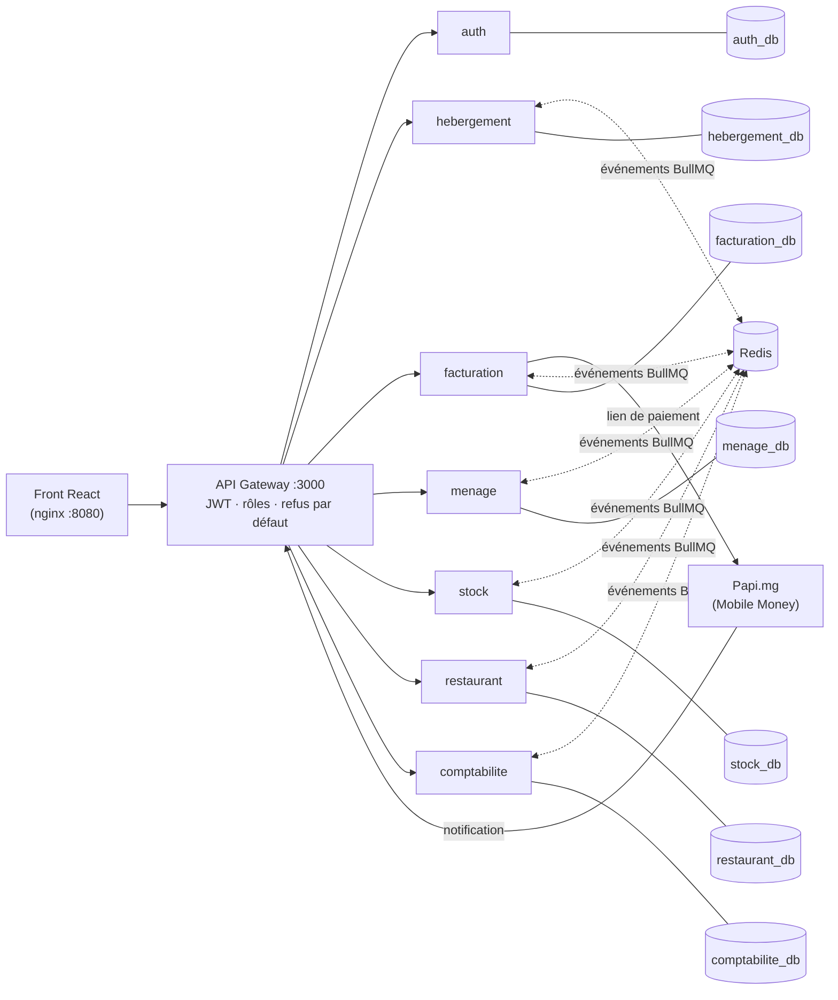

# Pitch — Hôtel & Restaurant, une architecture orientée services

Durée visée : **5 minutes** de présentation + questions. Les phrases à dire sont en texte normal ;
les indications de mise en scène sont *en italique*.

---

## 1. L'accroche (30 s)

Un hôtel-restaurant à Antananarivo, c'est sept métiers qui se parlent toute la journée : la réception,
le ménage, le stock, la cuisine, la facturation, la comptabilité et le client lui-même.
Aujourd'hui, ils se parlent sur papier, par téléphone… ou pas du tout. Résultat : des chambres
vendues deux fois, des repas jamais facturés et un stock qui ne correspond jamais à l'inventaire.

Nous avons modélisé ce processus en BPMN, puis nous l'avons transformé en une application
où **chaque métier est un service autonome**, et où les services se préviennent entre eux par des **événements**.

## 2. Ce que fait l'application (45 s)

*Démo rapide ou captures d'écran.*

- Le **client** réserve en ligne et paie par **Mobile Money avec Papi.mg** (MVola, Orange Money, Airtel Money). Il a 30 minutes ; sinon la chambre est libérée automatiquement.
- La **réception** fait le check-in, avec la pièce d'identité vérifiée et une chambre propre obligatoire, puis le check-out.
- La **femme de ménage**, sur son téléphone, démarre et termine ses chambres. Les articles remplacés sortent du stock tout seuls.
- Le **restaurant** prend les commandes et peut les **ajouter à la facture de la chambre**.
- La **comptabilité** reçoit chaque soir à 23 h un tableau de bord et sait ce qu'elle doit reverser au restaurant.

Sept rôles et une seule interface React, et chacun ne voit que ses écrans.

## 3. L'architecture SOA (1 min 30) — le cœur du pitch



Les **trois idées** à retenir :

**1. Un seul point d'entrée : l'API Gateway.**
Le navigateur et Papi ne parlent qu'à la gateway. Elle vérifie le jeton JWT, puis le rôle, grâce à une table
de droits (`REGLES`). Toute route absente de cette table est **refusée par défaut**. Les services, eux,
ne publient aucun port : ils exigent une **clé interne** que seule la gateway connaît.

**2. Une base de données par service.**
Sept bases PostgreSQL, et aucun service ne lit la base d'un autre. Si le restaurant tombe, on peut
toujours réserver et faire le ménage. Chaque équipe peut faire évoluer son schéma sans casser les autres.

**3. Les services communiquent par événements, de façon fiable.**
Un exemple, le **check-out** :

```
hebergement ──sejour.termine──► menage       (crée la tâche « ménage de départ »)
                            └──► facturation (clôture la facture si elle est soldée)
menage ──menage.termine──► hebergement (chambre « Propre »)
                       └──► stock       (sortie des articles remplacés)
facturation ──facture.cloturee──► comptabilite (copie + reversement au restaurant)
```

Neuf types d'événements en tout (`reservation.creee`, `reservation.confirmee`, `paiement.recu`, `sejour.commence`,
`sejour.termine`, `menage.termine`, `consommation.imputee`, `facture.cloturee`, `stock.seuil_atteint`), décrits et validés
par des schémas Zod dans le paquet partagé `packages/commun` (`evenements.ts`, avec la liste des abonnés de chacun).

Pour qu'aucun événement ne se perde, nous utilisons deux patrons :
- le **Transactional Outbox** : l'événement est écrit dans la **même transaction** que la donnée métier
  (table `outbox_evenement`), puis un relais l'envoie sur Redis/BullMQ. Si Redis est en panne, il partira plus tard ;
- des **consommateurs idempotents** : chaque événement traité est noté dans `evenement_traite`.
  Un doublon est donc ignoré : jamais deux sorties de stock pour un même ménage.

## 4. Les tables (1 min)

*Montrer le MCD Merise, puis ce tableau.*

| Service | Tables métier | Règle forte portée par la base |
|---|---|---|
| **auth** | `utilisateur`, `session` | téléphone et email uniques ; sessions révocables |
| **hebergement** | `categorie_chambre`, `chambre`, `saison`, `tarif_saison`, `reservation`, `reservation_nuitee`, `compteur_reservation` | **contrainte `EXCLUDE`** : une chambre ne peut pas être réservée deux fois sur des dates qui se chevauchent, même avec deux clics simultanés |
| **facturation** | `facture`, `ligne_facture`, `paiement`, `compteur_facture` | un seul paiement « en attente » par facture ; surpaiement refusé ; une ligne par origine (`@@unique(origine, sourceId)`) |
| **menage** | `tache_menage` | une tâche par réservation, par type et par jour (`@@unique`) |
| **stock** | `article`, `mouvement` | stock jamais négatif (décrément atomique) ; un mouvement par référence et par article |
| **restaurant** | `menu`, `plat`, `commande`, `ligne_commande`, `compteur_commande` | le prix est **toujours** recalculé par le serveur |
| **comptabilite** | `copie_facture`, `statistique_journaliere`, `controle_stock_journalier`, `reversement` | données **dupliquées volontairement** (copies) : la comptabilité ne dépend de personne |

Tables techniques présentes dans chaque service qui publie ou consomme des événements :
`outbox_evenement`, `evenement_traite`, ainsi que `cle_idempotence` pour les requêtes rejouées (en-tête `Idempotency-Key`).

Point de conception à souligner : **pas de clé étrangère entre services**. Par exemple, `facture.reservationId`
est un simple identifiant. La cohérence entre bases est assurée par les événements : c'est la
**cohérence à terme** (*eventual consistency*), le prix à payer pour l'autonomie des services.

## 5. Sécurité du paiement (30 s)

- Le **montant** est toujours calculé par notre serveur, jamais par le navigateur.
- La notification de Papi est authentifiée **deux fois** : par un jeton secret placé dans l'URL de notification
  (on n'en garde que l'empreinte SHA-256) et par le `notificationToken` donné par Papi.
- La page « paiement réussi » n'est **jamais** une preuve : seule la notification serveur à serveur fait foi.
- Le traitement passe par une file BullMQ : on répond 200 à Papi immédiatement, puis on réessaie en cas de panne passagère.

## 6. Qualité et méthode (30 s)

- **TypeScript de bout en bout** : Node 24, Express 5, Prisma 7, React 19, et Zod pour valider toutes les entrées.
- **Plus de 120 tests d'intégration** (Vitest + Supertest, sur de vraies bases de test) pour les règles critiques :
  surbooking, paiement, idempotence, stock, expiration à 30 minutes, droits de la gateway.
- Méthode : **2TUP** pour le cadrage, **Scrum** pour la réalisation, **Merise** pour les données, **UML** pour le reste.
  Chaque fonctionnalité suit le même chemin : branche → tests → PR → version notée avec Changesets.
- Tout démarre avec **Docker Compose** en une commande.

## 7. La suite et la conclusion (30 s)

La version 1.1 apporte une refonte de l'expérience : confirmations avant les actions irréversibles,
vues « Arrivées / Départs du jour », écrans pensés pour le téléphone de la femme de ménage
et la tablette du restaurant.

La V2 est déjà découpée en épopées : recettes et coût matière, stock prévisionnel avec date de rupture,
commande à distance, tableaux de bord décisionnels (taux d'occupation, RevPAR), et un **agent IA sur Facebook**
branché derrière une interface (patrons Adapter + Strategy) pour pouvoir changer de fournisseur d'IA.

**Conclusion** : nous n'avons pas seulement codé un site de réservation. Nous avons découpé un vrai
processus métier en services autonomes, qui restent cohérents même quand une partie tombe en panne.

---

## Questions probables du jury (et réponses courtes)

**Pourquoi des microservices plutôt qu'un monolithe ?**
Pour l'autonomie : sept métiers, sept cycles de vie, et une panne isolée. Nous en connaissons le coût :
plus d'infrastructure, une cohérence à terme et des tests plus complexes. Pour un seul hôtel, un monolithe modulaire
aurait suffi. Le projet a justement pour but de démontrer la SOA.

**Que se passe-t-il si Redis tombe ?**
Les écritures métier continuent. Les événements s'accumulent dans `outbox_evenement` et partent au redémarrage de Redis.

**Comment évitez-vous la double réservation ?**
Dans la base, pas dans le code : la contrainte `EXCLUDE` de PostgreSQL sur (chambre, plage de dates).
Deux transactions simultanées ne peuvent pas passer toutes les deux.

**Pourquoi dupliquer les factures dans la comptabilité ?**
Une base par service : la comptabilité garde sa propre copie, figée à la clôture. Elle ne dépend pas
de la disponibilité de la facturation, et la copie sert de trace d'audit.

**Comment testez-vous les événements ?**
Les tests d'intégration publient un événement, attendent son traitement, puis vérifient l'état de la base.
Le rejeu d'un même événement doit donner le même résultat.

**Et la montée en charge ?**
Les services sont sans état, et les sessions sont dans une base. On peut donc lancer plusieurs instances derrière la gateway.
BullMQ répartit les tâches entre les workers.
